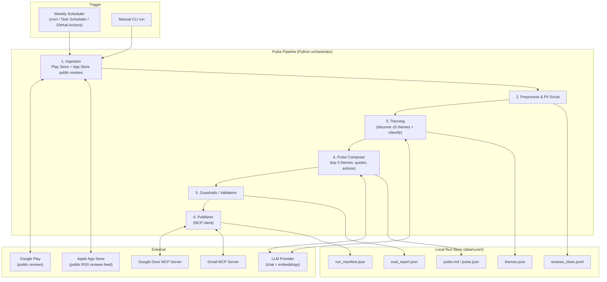
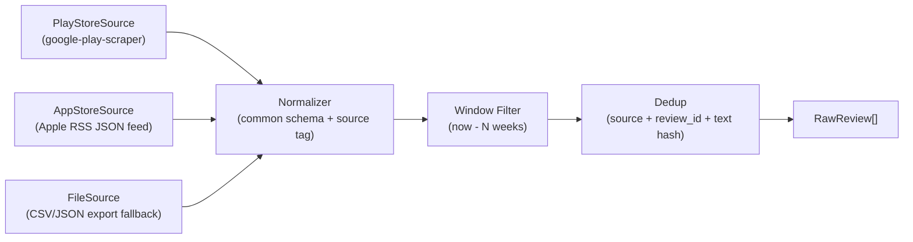
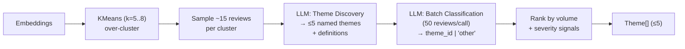
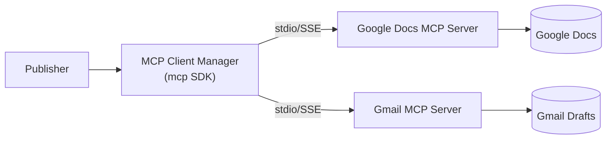
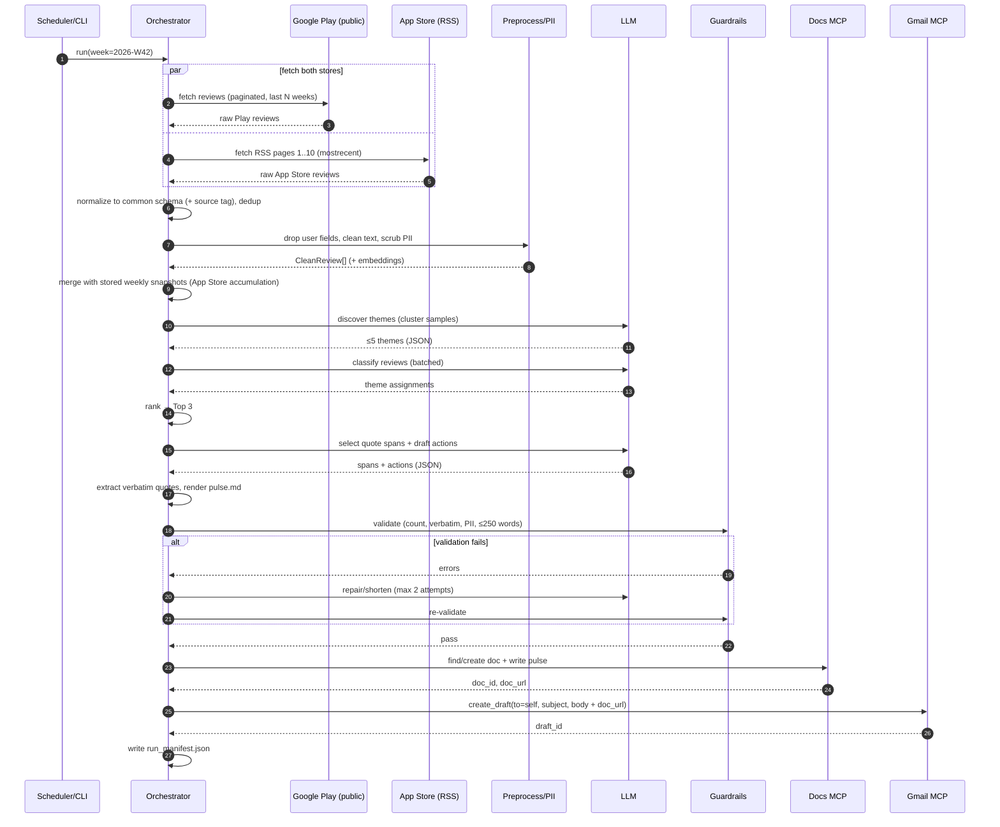

# Architecture — Groww Weekly Review Pulse Agent

> Source of requirements: [problemStatement.md](./problemStatement.md)
> Scope decision: **Google Play Store + Apple App Store (India storefront)** public reviews.

---

## 1. Goals & Non-Goals

### 1.1 Goals
- Ingest **public reviews** from a rolling **8–12 week** window, from two sources:
  - **Google Play:** `com.nextbillion.groww`
  - **Apple App Store:** `id1404871703`, India storefront
- Merge both sources into one review dataset with a common schema, keeping a `source` tag on each review.
- Remove **all PII** before any LLM call or saved artifact.
- Cluster reviews into **at most 5 themes** and rank them by volume.
- Generate a **one-page pulse (≤ 250 words)** with the **Top 3 themes**, **3 verbatim quotes**, and **3 action ideas**.
- Publish the pulse to **Google Docs** and create a **Gmail draft**, both **through MCP servers**.
- Ship **evals** that check every run against the constraints automatically.

### 1.2 Non-Goals
- Parsing App Store / Play Store web page HTML. Only public feeds and endpoints are used.
- Scraping behind logins or any automation that violates ToS.
- Direct Google REST/OAuth client code as the main integration path.
- Sending email automatically (we only create a **draft**).
- Real-time dashboards. This is a **weekly batch** job.

---

## 2. High-Level Architecture



### 2.1 Design Principles
| Principle | How it is applied |
|---|---|
| **Workflow first, agent where it helps** | A deterministic pipeline controls the order of steps. The LLM handles only judgment tasks: naming themes, classifying reviews, writing the pulse. |
| **Privacy by construction** | PII is removed at the ingestion boundary. Later stages never see raw reviewer data. |
| **Grounded generation** | The LLM picks quotes by `review_id` and span. Code copies the text, so the LLM cannot invent wording. |
| **MCP-first integrations** | Docs and Gmail are reached only through MCP tools, with no Google SDK code. |
| **Reproducible runs** | Each run is keyed by ISO week (e.g. `2026-W42`). All intermediate artifacts are saved. |
| **Fail closed** | If any guardrail fails, nothing is published. |

---

## 3. Technology Stack

| Concern | Choice (default) | Notes / Alternatives |
|---|---|---|
| Language | **Python 3.11+** | Strong ecosystem for NLP, MCP SDK, and data processing |
| Review source — Play | **`google-play-scraper`** (public reviews endpoint, no login) | A manually exported CSV/JSON of public reviews is supported as a fallback |
| Review source — iOS | **Apple public RSS customer-reviews feed** (JSON) via `httpx` | No login or API key needed. A manually exported CSV/JSON is the fallback. |
| Data models | **Pydantic v2** | Typed contracts between stages |
| LLM (chat) | Groq (`LLM_PROVIDER=groq`) on its free tier; other providers are configurable via `LLM_PROVIDER`. Two Groq models: `openai/gpt-oss-120b` for discovery, residual naming and composition, and `openai/gpt-oss-20b` for per-review classification | Each model has its own daily token quota and ledger (see §10, *LLM token budget*) |
| Embeddings | Provider embeddings or `sentence-transformers` (local) | Used for clustering, dedup, and quote-candidate retrieval |
| Clustering | `scikit-learn` (KMeans, k ≤ 5) | HDBSCAN is an alternative for exploration |
| PII detection | Regex rules + optional **Microsoft Presidio** | India-specific recognizers: PAN, Aadhaar, UPI, IFSC, phone |
| MCP client | **`mcp` Python SDK** (stdio / SSE transports) | Connects to the Docs and Gmail MCP servers |
| Config | `pydantic-settings` + `.env` + `config.yaml` | Secrets are never committed |
| CLI | `typer` | `pulse run`, `pulse eval`, `pulse publish` |
| Testing / Evals | `pytest` + a custom eval harness | LLM-as-judge for qualitative checks |
| Logging | `structlog` (JSON logs) | Records token usage and step timings |

---

## 4. Component Design

### 4.1 Ingestion (`ingest/`)

**Responsibility:** Fetch public reviews from **both stores** for the configured window and normalize them into one list of `RawReview` records, each tagged with `source`.



All sources implement one interface, `ReviewSource.fetch(window_start) -> Iterable[RawReview]`. The orchestrator runs them **concurrently**. If one source fails, the run continues with the other and the gap is recorded in the run manifest.

#### 4.1.1 Google Play — `PlayStoreSource`
- **Call:** `reviews(app_id="com.nextbillion.groww", lang="en", country="in", sort=NEWEST)`, paginated with a continuation token until `at < window_start`.
- **Fields kept:** `reviewId` (internal only), `score`, `content`, `at`, `appVersion`/`reviewCreatedVersion`, `thumbsUpCount`.
- **Fields dropped immediately:** `userName`, `userImage`, `replyContent`, `repliedAt`.
  - Developer replies are dropped because they are not user voice.
- The Play Store has **no review title**, so `title = None`.

#### 4.1.2 Apple App Store — `AppStoreSource`
- **Store page (reference only):** https://apps.apple.com/in/app/groww-stocks-mutual-fund-ipo/id1404871703?see-all=reviews&platform=iphone
- **Feed used:** `https://itunes.apple.com/in/rss/customerreviews/page={n}/id=1404871703/sortby=mostrecent/json`
  - `n` runs from 1 to 10. Each page has up to 50 reviews, newest first.
  - Paging stops when a page is empty or when `updated < window_start`.
- **Fields kept:** `id.label` (internal only), `im:rating`, `title`, `content`, `updated`, `im:version`, `im:voteSum` / `im:voteCount`.
- **Fields dropped immediately:** `author.name`, `author.uri`, and any links.
- **Feed cap:** Apple serves at most **~500 of the newest reviews** per storefront. The pipeline handles this cap in two ways:
  - **Weekly accumulation:** each weekly run saves that week's cleaned App Store reviews, and the 8–12 week window is assembled from the saved weeks plus the current fetch. Once a few weekly runs have happened, coverage is full even if one fetch can't reach back 12 weeks.
  - **Backfill:** on the first run, a `FileSource` import of a public export (if one is available) fills older weeks.
  - **Coverage tracking:** the oldest review date reached is saved as `coverage_start` in the run manifest. If the window is not fully covered, the pulse header says so.

#### 4.1.3 Field Mapping to the Common Schema

| `RawReview` field | Google Play | App Store (RSS) |
|---|---|---|
| `source` | `"play_store"` | `"app_store"` |
| `review_id` | `reviewId` | `id.label` |
| `rating` | `score` | `im:rating.label` (int) |
| `title` | — (`None`) | `title.label` |
| `text` | `content` | `content.label` |
| `date` | `at` | `updated.label` (ISO 8601 → UTC) |
| `app_version` | `reviewCreatedVersion` | `im:version.label` |
| `helpful_votes` | `thumbsUpCount` | `im:voteSum.label` (int, default 0) |

#### 4.1.4 Common Ingestion Rules
- **Window:** `WINDOW_WEEKS` (default **10**, allowed range **8–12**). It applies to both sources.
- **Language:** English first. Hinglish/Hindi reviews are kept if they appear, and language detection tags them so the theming step can handle them.
- **Rate limiting:** polite pagination with a sleep between pages, retries with exponential backoff, and a max-review cap per source (`MAX_REVIEWS`, default 5,000 for Play and 500 for App Store).
- **Compliance:** only public listings and feeds are used, with no authentication. If ToS concerns come up, switch either source to `FileSource` with a manually exported public dataset.

### 4.2 Preprocess & PII Scrub (`preprocess/`)

**Responsibility:** Clean text and remove all PII. This is the **privacy boundary**: nothing raw goes past this stage.

| Step | Detail |
|---|---|
| Normalize | Unicode NFC, collapse whitespace, strip zero-width characters |
| Filter noise | Drop empty or emoji-only reviews and reviews with 8 words or fewer (`ingest.min_words`, configurable) |
| PII scrub | Replace matches with typed placeholders (see table below) |
| Pseudonymize ID | `(source, review_id)` → `rid_<sha256[:10]>`. The original ID is never written to disk. |
| Title handling | App Store `title` is scrubbed the same way as the body. For theming, the text sent to the model is `title + ". " + text`. Quotes are taken from the body (`clean_text`) only. |
| Language tag | `langdetect` / `fasttext`, stored as `lang` |
| Embedding | Compute and cache the vector per cleaned review |

**PII patterns (India-aware):**

| Type | Example pattern | Replacement |
|---|---|---|
| Email | `\S+@\S+\.\S+` | `[EMAIL]` |
| Phone (IN) | `(\+91[\-\s]?)?[6-9]\d{9}` | `[PHONE]` |
| PAN | `[A-Z]{5}\d{4}[A-Z]` | `[PAN]` |
| Aadhaar | `\d{4}\s?\d{4}\s?\d{4}` | `[AADHAAR]` |
| UPI ID | `[\w.\-]+@[a-z]{2,}` (non-email handles) | `[UPI]` |
| Bank acct / IFSC | `\d{9,18}`, `[A-Z]{4}0[A-Z0-9]{6}` | `[ACCOUNT]`, `[IFSC]` |
| Order / ticket IDs | Long alphanumeric tokens | `[ID]` |
| Person names | Presidio `PERSON` (optional) | `[NAME]` |
| URLs | `https?://\S+` | `[URL]` |

> Quotes are chosen from **scrubbed** text. The scrubbed text is the "verbatim" source of truth, so placeholders such as `[PHONE]` may appear in a quote. That is allowed and preferred over leaking PII.

### 4.3 Theming (`theming/`)

**Responsibility:** Produce **at most 5 themes**, assign each review to a theme, and rank themes.

Hybrid **discover → classify → rank** approach:



1. **Over-cluster** embeddings (k = 5–8) to get diverse samples cheaply.
2. **Theme discovery (LLM):** send cluster samples and a **seed taxonomy hint** (onboarding, KYC, payments/UPI, withdrawals, statements, app performance, F&O/trading, customer support, charges/brokerage). The LLM returns **≤ 5 themes**, each with `name`, `definition`, and `inclusion/exclusion` rules. A Pydantic schema enforces structured JSON output.
3. **Classification (LLM, sampled):** classify reviews in batches into one theme or `other`. To fit Groq's free tier, only a capped sample of fresh reviews (`llm.classify.max_reviews_per_run`, default 500) goes to the LLM, on the classify model. Every other review, and any review the LLM fails or is unsure about, is labelled by a logistic-regression model trained on the LLM's own answers for that run (cached ones included), which costs no tokens; if there are too few answers to learn from, it falls back to the nearest theme centroid (TF-IDF cosine). Every review still gets exactly one theme. Per-review results are cached, so re-running the same week is nearly free.
   - **Residual pass:** if `other` is large, the heavy model names one more theme from a sample of `other`. Re-sorting `other` then runs on the classify model, capped at `llm.classify.max_residual_reviews` (default 250); the rest use centroids.
4. **Ranking:**
   - Themes are discovered and classified on the **combined** dataset from both stores, so one taxonomy covers both.
   - Primary key: combined review count.
   - Tie-breakers: share of 1–2★ reviews, helpful-vote weight, and week-over-week growth.
   - Each theme also records a **per-source breakdown** (`by_source`). This shows when an issue is mostly on one platform, e.g. an iOS-only crash.
   - Play Store usually has far more reviews than the App Store. To keep iOS issues from being drowned out, `ranking.source_weighting` can be set to `balanced`, which averages each source's share instead of using raw counts. The default is `volume`.
5. **Constraint enforcement:** if the LLM returns more than 5 themes, the smallest are merged into the nearest theme or into `other`. `other` is never shown as a top theme.

**Optional stability:** themes from the previous week are passed in as hints so names stay consistent across weeks. This makes trends easier to compare.

### 4.4 Pulse Composer (`compose/`)

**Responsibility:** Build the one-page note from the Top 3 themes.

#### 4.4.1 Quote Selection (grounded, verbatim)
1. For each Top-3 theme, retrieve **candidate reviews** from both sources: most helpful votes, most representative (nearest to centroid), with a mix of ratings.
2. The LLM returns `{review_id, start_char, end_char}` spans, **not text**.
3. Code extracts `quote = clean_text[start:end]`, which makes the quote **verbatim by construction**.
4. Rules: 8–40 words per quote, one quote per theme (3 total), PII re-check, and no profanity (configurable).
5. **Source mix (soft rule):** if both sources have suitable candidates, at least one of the 3 quotes should come from each store. Each quote is labelled with its store.

#### 4.4.2 Action Ideas
- The LLM gets the theme definitions, stats, and selected quotes. It returns **3 actions**, each with `title`, `rationale`, `linked_theme_id`, and `owner_hint` (Product / Support / Eng).
- Every action **must reference** a Top-3 theme. A validator rejects ungrounded actions.

#### 4.4.3 Note Rendering
A Jinja2 template renders `pulse.md`. The same content is mapped to Docs formatting at publish time.

```markdown
# Groww App Reviews Pulse — Week 2026-W42
Window: 2026-08-05 → 2026-10-13 · Reviews: 3,412 (Play 3,020 · App Store 392) · Avg: Play 3.5★ · iOS 3.9★

## Top Themes
1. **Withdrawals & Payouts** — 24% of reviews (↑ 5 pts WoW), 71% are 1–2★
2. **App Performance** — 19%, crashes during market open (mostly Android)
3. **KYC & Onboarding** — 14%, delays in verification

## What Users Said
> "…verbatim quote…" — 1★, Play Store, Oct 2026
> "…verbatim quote…" — 2★, App Store, Sep 2026
> "…verbatim quote…" — 4★, Play Store, Oct 2026

## Action Ideas
1. **…** — rationale (Theme 1)
2. **…** — rationale (Theme 2)
3. **…** — rationale (Theme 3)
```

- **Word budget:** ≤ 250 words, excluding the header metadata line. If a draft is over budget, up to two LLM shorten passes run on theme definitions and action rationales. If the pulse is still over 250, a staged deterministic clamp trims those fields harder until it fits (the last stage drops definitions). Quotes, titles and the stats lines are never edited, so the clamp is the guarantee that the cap holds.

### 4.5 Guardrails / Validators (`guardrails/`)

These run **before publishing**. Any hard failure blocks the publish step.

| Check | Type | Rule |
|---|---|---|
| Theme count | Hard | `1 ≤ len(themes) ≤ 5`, exactly 3 in the pulse |
| Quote count | Hard | Exactly 3 |
| Verbatim | Hard | Each quote is an exact substring of some `clean_text` in the run store |
| PII | Hard | Re-scan the final pulse with every PII recognizer: zero hits |
| Word limit | Hard | `word_count(pulse_body) ≤ 250` |
| Action count & grounding | Hard | 3 actions, each linked to a Top-3 theme |
| No identifiers | Hard | No `rid_*` or internal IDs in the published text |
| Source attribution | Hard | Each quote's store label matches the `source` of the review it came from |
| Source coverage | Soft | Warn if a source returned 0 reviews or did not cover the full window |
| Tone / factuality | Soft | LLM-as-judge score ≥ threshold, otherwise a warning |

### 4.6 Publisher — MCP Client (`publish/`)

**Responsibility:** Deliver the pulse to Google Docs and Gmail **only through MCP tools**.



- **Server registry:** `mcp_servers.yaml` defines how to launch or connect to each server (command, args, env, transport). The MCP servers handle OAuth themselves. Our code never sees Google tokens.
- **Tool discovery:** on startup, call `list_tools()` and map the logical operations to whatever tool names the configured server exposes:

| Logical op | Typical MCP tool (server-dependent) | Purpose |
|---|---|---|
| `docs.find` | `search_documents` / `list_docs` | Find this week's doc (idempotency) |
| `docs.create` | `create_document` | Create `Groww App Reviews Pulse — 2026-W42` |
| `docs.write` | `insert_text` / `batch_update` / `append_text` | Write headings, lists, quotes |
| `docs.link` | (returned by create) | Get the shareable URL |
| `gmail.draft` | `create_draft` / `draft_email` | Draft to `PULSE_RECIPIENT` |

- **Adapter pattern:** `DocsPublisher` and `GmailPublisher` interfaces with MCP-backed implementations. If the server changes, only the tool-name mapping in config changes.
- **Idempotency:**
  - Before creating a doc, search for a doc with this week's title. If found, **update** it instead of creating a duplicate.
  - Save `doc_id`, `doc_url`, and `draft_id` in `run_manifest.json`. A re-run updates the existing doc and replaces the draft.
- **Email draft content:**
  - Subject: `Groww App Reviews Pulse — 2026-W42`
  - Body: the full pulse (plain text + HTML), a link to the Google Doc, and a footer noting the window and the review count per store.
  - Recipient: `PULSE_RECIPIENT` (self or alias). **Draft only, never sent.**
- **Optional agentic mode:** an LLM agent gets the MCP tools plus the validated pulse and runs the publish steps itself. Even then, the content it may write is fixed to the validated pulse.

---

## 5. End-to-End Sequence



---

## 6. Data Models (Pydantic)

```python
Source = Literal["play_store", "app_store"]

class RawReview(BaseModel):          # in-memory only, never persisted
    source: Source
    review_id: str
    rating: int                      # 1..5
    title: str | None = None         # App Store only
    text: str
    date: datetime
    app_version: str | None
    helpful_votes: int = 0           # Play thumbsUp / App Store voteSum

class CleanReview(BaseModel):        # persisted: reviews_clean.jsonl
    rid: str                         # pseudonymous: rid_<hash(source, review_id)>
    source: Source
    rating: int
    clean_title: str | None = None   # PII-scrubbed; Play Store has no title
    clean_text: str                  # PII-scrubbed body
    date: date
    iso_week: str                    # "2026-W40"
    app_version: str | None
    helpful_votes: int
    lang: str
    pii_hits: list[str] = []         # types only, e.g. ["PHONE"]

class Theme(BaseModel):
    theme_id: str                    # "t1".."t5"
    name: str
    definition: str
    review_count: int
    share: float                     # 0..1
    avg_rating: float
    low_rating_share: float          # share of 1–2★
    wow_delta: float | None          # week-over-week change in share
    by_source: dict[Source, int]     # e.g. {"play_store": 640, "app_store": 85}

class Quote(BaseModel):
    rid: str                         # internal, never rendered
    source: Source                   # rendered as "Play Store" / "App Store"
    theme_id: str
    text: str                        # exact substring of clean_text
    rating: int
    month: str                       # "Oct 2026"

class ActionIdea(BaseModel):
    title: str
    rationale: str
    theme_id: str
    owner_hint: Literal["Product", "Support", "Engineering", "Growth"]

class Pulse(BaseModel):
    week: str
    window_start: date
    window_end: date
    total_reviews: int
    reviews_by_source: dict[Source, int]
    avg_rating_by_source: dict[Source, float]
    avg_rating: float
    top_themes: conlist(Theme, min_length=3, max_length=3)
    quotes: conlist(Quote, min_length=3, max_length=3)
    actions: conlist(ActionIdea, min_length=3, max_length=3)
    markdown: str
    word_count: int

class RunManifest(BaseModel):
    run_id: str
    week: str
    started_at: datetime
    finished_at: datetime | None
    status: Literal["success", "failed_validation", "failed_publish", "error"]
    counts: dict[str, int]           # fetched/kept per source, scrubbed, classified
    coverage_start: dict[Source, date]  # oldest review reached per source
    source_errors: dict[Source, str]    # empty if both sources succeeded
    llm_usage: dict[str, int]        # tokens in/out per step
    doc_id: str | None
    doc_url: str | None
    draft_id: str | None
    eval_summary: dict[str, bool]
```

---

## 7. Prompting Strategy

| Step | Input | Output (structured JSON) | Key instructions |
|---|---|---|---|
| Theme discovery | Cluster samples (scrubbed), seed taxonomy | `themes[≤5]{name, definition, include, exclude}` | "Max 5 themes, mutually exclusive, product-specific, no PII" |
| Classification | Theme defs + batch of `{rid, text}` | `[{rid, theme_id \| "other", confidence}]` | "Choose exactly one; use 'other' if none fit" |
| Quote selection | Theme + candidate reviews `{rid, text}` | `{rid, start_char, end_char}` | "Select a contiguous span; do NOT rewrite text" |
| Actions | Top-3 themes + stats + quotes | `actions[3]{title, rationale, theme_id, owner_hint}` | "Concrete, specific to Groww, one per theme, grounded in evidence" |
| Shorten/repair | Draft pulse + violations | Revised sections | "Never alter quotes; reduce to ≤250 words" |

- All prompts live in `prompts/*.md` and are versioned. The prompt version is recorded in the run manifest.
- Temperature is low (0–0.3) for classification and higher (~0.5) for writing actions.
- Every LLM response is parsed with Pydantic. Parse failures trigger one retry with the error message included.

---

## 8. Evaluation Framework (`evals/`)

### 8.1 Automated (every run)
Same checks as the guardrails in §4.5. The results are written to `eval_report.json`.

### 8.2 Offline Eval Suite (`pulse eval`)

| Eval | Method | Target |
|---|---|---|
| **Quote faithfulness** | Exact substring match against the source corpus | 100% |
| **PII leakage** | Synthetic reviews with injected PII (phones, PAN, emails, names) → scan outputs | 0 leaks |
| **Theme quality** | Hand-labelled golden set (~200 reviews) → classification accuracy / macro-F1 | ≥ 0.75 F1 |
| **Theme coherence** | LLM-as-judge: "Do these 10 reviews belong to theme X?" | ≥ 4/5 avg |
| **Action groundedness** | LLM-as-judge: is each action supported by theme evidence? | ≥ 4/5 avg |
| **Length compliance** | Word count | ≤ 250 |
| **Stability** | Run twice on the same data → theme overlap (Jaccard on names/assignments) | ≥ 0.7 |
| **MCP publish** | Integration test against a sandbox doc/draft | Doc + draft created |

### 8.3 Fixtures
- `evals/fixtures/reviews_sample.jsonl`: frozen, scrubbed sample used for deterministic tests.
- `evals/fixtures/pii_injection.jsonl`: adversarial PII cases.
- `evals/golden/theme_labels.csv`: human labels.

---

## 9. Project Structure

```text
Groww_review_AI-agent/
├── Docs/
│   ├── problemStatement.md
│   └── architecture.md
├── src/pulse/
│   ├── __init__.py
│   ├── cli.py                    # typer: run | eval | publish | fetch
│   ├── config.py                 # pydantic-settings
│   ├── orchestrator.py           # pipeline controller
│   ├── models.py                 # Pydantic data contracts
│   ├── ingest/
│   │   ├── base.py               # ReviewSource interface
│   │   ├── playstore_source.py
│   │   ├── appstore_source.py    # Apple RSS customer-reviews feed
│   │   ├── file_source.py
│   │   └── normalizer.py
│   ├── preprocess/
│   │   ├── cleaner.py
│   │   ├── pii.py                # regex + presidio recognizers
│   │   └── embeddings.py
│   ├── theming/
│   │   ├── cluster.py
│   │   ├── discover.py
│   │   ├── classify.py
│   │   └── rank.py
│   ├── compose/
│   │   ├── quotes.py
│   │   ├── actions.py
│   │   ├── render.py
│   │   └── templates/pulse.md.j2
│   ├── guardrails/
│   │   └── validators.py
│   ├── publish/
│   │   ├── mcp_client.py         # session mgmt, tool discovery
│   │   ├── docs_publisher.py
│   │   └── gmail_publisher.py
│   ├── llm/
│   │   ├── client.py             # provider abstraction
│   │   └── prompts/*.md
│   └── observability/
│       └── logging.py
├── evals/
│   ├── run_evals.py
│   ├── judges.py
│   ├── fixtures/
│   └── golden/
├── tests/                        # unit + integration
├── config/
│   ├── config.yaml
│   └── mcp_servers.yaml
├── data/runs/<iso_week>/         # gitignored run artifacts
├── .env.example
├── pyproject.toml
└── README.md
```

---

## 10. Configuration

### LLM token budget (Groq free tier)

Groq's free tier allows about 200k tokens/day and 8k tokens/minute **per model**. The daily limit is a rolling 24-hour bucket that refills continuously (about 8.3k tokens/hour per 200k/day), not a reset at midnight. The ledger drains at the same rate and adopts the `Used` figure from Groq's 429 message, so usage it cannot see is picked up. Labelling every review with an LLM cost ~120k tokens for 1,500 reviews, so a full run used a whole day's quota. The design now spends tokens only where judgement is needed:

| Step | Model | Tokens per run |
|---|---|---|
| Theme discovery, residual naming, compose | `gpt-oss-120b` (`llm_budget.json`) | ~20–30k |
| Classify a sample of ≤ 500 reviews + residual ≤ 250 | `gpt-oss-20b` (`llm_budget_classify.json`) | ~55–60k |

About 3 cold runs fit per day (`llm.budget.max_runs_per_day: 3`); re-runs of the same week reuse the classification cache. Calls are paced under the tokens-per-minute limit, so a run takes roughly 15–20 minutes. 401/403/404 responses (wrong model name or key) fail immediately instead of retrying; a 400 `json_validate_failed` (bad JSON reply) falls back for that batch without retrying. `pulse budget` and the web header show both ledgers.

**`.env`** (secrets, gitignored)
```dotenv
LLM_PROVIDER=groq              # groq (default, free tier) | mock
LLM_API_KEY=...                # Groq key; both models below must be listed for it
PULSE_RECIPIENT=me@example.com
```

**`config/config.yaml`**
```yaml
sources:
  play_store:
    enabled: true
    package_id: com.nextbillion.groww
    country: in
    lang: en
    max_reviews: 5000
  app_store:
    enabled: true
    app_id: "1404871703"
    country: in
    max_pages: 10           # Apple RSS limit (~50 reviews/page)
    accumulate_weekly: true # build the window from stored weekly snapshots
ingest:
  window_weeks: 10          # 8..12
  min_words: 8              # reviews with <= 8 words are dropped
  min_reviews: 50           # below this, add a low-volume banner
ranking:
  source_weighting: volume  # volume | balanced
theming:
  max_themes: 5
  top_k: 3
  seed_taxonomy: [onboarding, kyc, payments_upi, withdrawals, statements,
                  app_performance, trading_fno, customer_support, charges]
compose:
  max_words: 250
  quote_words: [8, 40]
llm:
  model_chat: openai/gpt-oss-120b      # discovery, residual naming, compose
  model_embed: tfidf-svd               # local TF-IDF + SVD, no key
  max_completion_tokens: 4000          # hard cap per reply (bounds hidden reasoning)
  temperature: { classify: 0.0, compose: 0.4 }
  classify:                            # own Groq model, own daily quota and ledger
    model: openai/gpt-oss-20b
    daily_token_limit: 200000
    max_reviews_per_run: 500           # fresh reviews sent to the LLM; the rest use centroids
    max_residual_reviews: 250
  budget: { max_runs_per_day: 3, daily_token_limit: 200000, safety_margin: 0.9 }
publish:
  doc_title_template: "Groww App Reviews Pulse — {week}"
  docs_folder: "Groww Pulse"   # if supported by MCP server
  create_gmail_draft: true
```

**`config/mcp_servers.yaml`**
```yaml
servers:
  gdocs:
    transport: stdio
    command: <docs-mcp-server-command>
    args: []
    tool_map:
      find: <tool_name>
      create: <tool_name>
      write: <tool_name>
  gmail:
    transport: stdio
    command: <gmail-mcp-server-command>
    args: []
    tool_map:
      draft: <tool_name>
```

---

## 11. Scheduling & Operations

- **Cadence:** weekly, Monday 09:00 IST (`0 9 * * 1`), via Windows Task Scheduler, cron, or GitHub Actions.
- **CLI:**
  - `pulse run --week auto`: full pipeline
  - `pulse run --dry-run`: everything except MCP publish
  - `pulse publish --week 2026-W42`: re-publish saved artifacts
  - `pulse eval`: offline eval suite
- **Observability:** JSON logs per step with timings, counts, token usage, and cost estimate. The run manifest is the audit record.
- **Retention:** cleaned reviews from both sources are kept for 12 weeks. This supports WoW trends and App Store weekly accumulation. Raw reviews are **never** saved.

---

## 12. Error Handling & Resilience

| Failure | Handling |
|---|---|
| Play Store fetch errors / throttling | Exponential backoff (max 5). Partial data is accepted if ≥ 70% of the expected window is covered. Otherwise the run continues with the App Store only and records the gap. |
| App Store RSS errors / empty pages | Retry with backoff. An empty page ends paging normally. If the whole feed fails, continue with the Play Store only and record the gap. |
| App Store 500-review cap hit before window start | Use stored weekly snapshots for older weeks, set `coverage_start`, and show a coverage note in the pulse header |
| Both sources fail | Abort the run and publish nothing |
| Too few reviews (< 50) | Generate the pulse with a "low volume" banner, or skip based on config |
| LLM malformed JSON | Retry once with the validation error, then fall back to an embedding-only clustering label |
| Guardrail failure | Up to 2 automatic repair passes. If it still fails, mark `failed_validation` and do not publish. |
| MCP server unavailable | Retry connection 3×. Save the pulse locally and mark `failed_publish`. `pulse publish` can retry later. |
| Duplicate run in same week | Idempotent: update the existing doc and replace the draft |

---

## 13. Security & Privacy

- **PII:** removed at the ingestion boundary. Reviewer names, avatars, and original review IDs are never saved or sent to the LLM.
- **LLM data exposure:** only scrubbed text goes to the LLM provider.
- **Credentials:** Google OAuth is handled entirely by the MCP servers. The app only holds the LLM API key, stored in `.env` and never logged.
- **Least privilege:** MCP servers are configured with the narrowest scopes needed: Docs create/edit and Gmail **compose/drafts** (not send).
- **Output review:** every published artifact passes the PII re-scan first.

---

## 14. Implementation Roadmap

| Phase | Scope | Exit criteria |
|---|---|---|
| **P1 — Ingest & Scrub** | Play Store + App Store sources, common schema, normalizer, PII scrubber, run store | `reviews_clean.jsonl` with both sources for 10 weeks, PII injection tests pass |
| **P2 — Theming** | Embeddings, clustering, LLM discovery and classification, ranking | ≤5 themes, golden-set F1 ≥ 0.75 |
| **P3 — Compose & Guardrails** | Quote spans, actions, renderer, validators | Pulse ≤250 words, all hard checks pass |
| **P4 — MCP Publish** | MCP client, Docs and Gmail publishers, idempotency | Doc created/updated + Gmail draft with link |
| **P5 — Evals & Ops** | Offline eval suite, scheduler, logging, README | `pulse eval` green, weekly schedule live |

---

## 15. Open Decisions

| # | Decision | Default assumed |
|---|---|---|
| 1 | LLM provider / model | Configurable; pick one for P2 |
| 2 | Specific Docs & Gmail MCP servers | Whatever the course environment provides; mapped via `tool_map` |
| 3 | Window length | 10 weeks (within 8–12) |
| 4 | Hindi/Hinglish reviews | Include and classify. Prefer English quotes. |
| 5 | Email body | Full pulse inline + Doc link |
| 6 | Theme ranking across stores | `volume` (raw combined counts). Switch to `balanced` if iOS issues get drowned out. |
| 7 | App Store history beyond ~500 reviews | Weekly accumulation, plus an optional one-time backfill from a public export |
