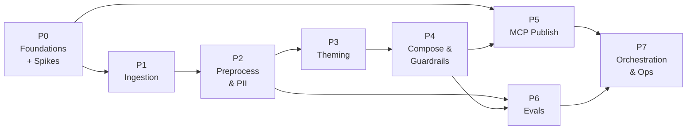

# Implementation Plan — Groww Weekly Review Pulse Agent

> Based on: [problemStatement.md](./problemStatement.md) · [architecture.md](./architecture.md)
> Sources in scope: **Google Play Store** + **Apple App Store (India)**

---

## 0. Plan at a Glance

| Phase | Name | Main Output | Est. Effort |
|---|---|---|---|
| **P0** | Foundations & De-risking Spikes | Repo skeleton, config, models, LLM client; MCP + feed spikes verified | 1–2 days |
| **P1** | Review Ingestion (Play + App Store) | `RawReview[]` from both stores, weekly snapshots | 2 days |
| **P2** | Preprocessing & PII Scrubbing | `reviews_clean.jsonl` with zero PII + embeddings | 1–2 days |
| **P3** | Theming (Discover → Classify → Rank) | `themes.json` with ≤5 ranked themes | 2–3 days |
| **P4** | Pulse Composition & Guardrails | `pulse.md` / `pulse.json` (≤250 words) that pass every hard check | 2 days |
| **P5** | MCP Publishing (Docs create/append + Email draft/send) | Pulse appended to a Google Doc (auto-created) and drafted or sent to self through our MCP server (4 tools, all live) | 1–2 days |
| **P6** | Evaluation Suite | `pulse eval` with golden set, PII injection, LLM judges | 2 days |
| **P7** | Orchestration, Scheduling & Hardening | `pulse run` end-to-end, weekly schedule, README | 1–2 days |

**Total:** about 12–17 working days for one developer.

> [!TIP]
> P5 (MCP publishing) depends only on P0 plus a sample `pulse.md`. It can be built **in parallel** with P1–P4 using a hard-coded fixture pulse. The MCP server is already deployed (`mcpserver-production-da04.up.railway.app`) with all four tools live and manually tested: `google_docs_create`, `google_docs_append_text`, `gmail_create_draft` and `gmail_send_email` (server commit `2c2a701`, task 5.0a done). P5 only has the client side left to build.

---

## Phase 0 — Foundations & De-risking Spikes

**Goal:** Set up a working project skeleton, and test the two riskiest external dependencies (the MCP servers and the App Store feed) before building on them.

### Tasks

**0.1 Project scaffold**
- [x] Create `pyproject.toml` (Python 3.11+). Core dependencies:
  - `pydantic`, `pydantic-settings`, `typer`, `httpx`, `structlog`
  - `google-play-scraper`, `scikit-learn`, `jinja2`, `mcp`
  - `pytest`, `pytest-asyncio`, `respx`
- [x] Create the folder layout from [architecture §9](./architecture.md): `src/pulse/{ingest,preprocess,theming,compose,guardrails,publish,llm,observability}`, plus `evals/`, `tests/`, `config/`, `data/`.
- [x] Add `.gitignore` covering `data/`, `.env`, and caches.
- [x] Add `.env.example`.
- [x] Set up `ruff` + `mypy` and a pre-commit hook.

**0.2 Configuration**
- [x] `config.py`: `Settings` loads `.env` (secrets) and `config/config.yaml` (behaviour).
- [x] Validate ranges: `window_weeks ∈ [8,12]`, `max_themes ≤ 5`, `max_words ≤ 250`.
- [x] `config/mcp_servers.yaml` with placeholder `tool_map`.

**0.3 Data contracts**
- [x] `models.py`: `RawReview`, `CleanReview`, `Theme`, `Quote`, `ActionIdea`, `Pulse`, `RunManifest`, and the `Source` literal (exactly as in [architecture §6](./architecture.md)).

**0.4 Cross-cutting utilities**
- [x] `observability/logging.py`: structlog JSON logger that binds `run_id`, `week`, and `step`.
- [x] `run_store.py`: read/write helpers for `data/runs/<iso_week>/` and `data/snapshots/<source>/<iso_week>.jsonl`.
- [x] `utils/weeks.py`: ISO-week helpers (`current_week()`, `window_bounds(week, n)`).

**0.5 LLM client abstraction**
- [x] `llm/client.py`: `LLMClient` protocol with three methods:
  - `complete_json(prompt, schema, temperature) -> BaseModel`
  - `embed(texts) -> list[list[float]]`
  - a token-usage counter
- [x] One concrete provider implementation, chosen by `LLM_PROVIDER` (Groq for chat + local `sentence-transformers` for embeddings, plus `MockLLMClient`).
- [x] Built-in behaviour: retry with backoff, and one re-prompt that includes the validation error if Pydantic parsing fails.

**0.6 CLI skeleton**
- [x] `cli.py` (typer) with stub commands: `fetch`, `run`, `publish`, `eval`, `config`.

**0.7 🔬 Spike A — MCP servers**
- [x] Build probe script `scripts/mcp_probe.py` that connects to servers in `config/mcp_servers.yaml`, calls `list_tools()`, and validates schemas against `tool_map`. (Live OAuth execution deferred per user choice; placeholder config verified).

**0.8 🔬 Spike B — Review sources**
- [x] Fetch a single page from `https://itunes.apple.com/in/rss/customerreviews/page=1/id=1404871703/sortby=mostrecent/json` and confirm the JSON shape and field names.
- [x] Fetch all 10 pages and record how far back the ~500 reviews reach (~6.0 weeks reached; verified that weekly snapshot accumulation is required).
- [x] Fetch 200 Play Store reviews with `google-play-scraper` and confirm the fields.
- [x] Save small, scrubbed samples to `tests/fixtures/` for offline tests.
- [x] Documented findings in [`Docs/phase0-spikes.md`](./phase0-spikes.md).

### Exit Criteria
- [x] `pulse --help` works.
- [x] `pytest` runs, with all 27 unit tests passing.
- [x] MCP probe script lists tools or reports placeholder status cleanly.
- [x] App Store coverage depth (in weeks) is known and documented (~6.0 weeks / 42 days).

---

## Phase 1 — Review Ingestion (Play Store + App Store)

**Goal:** Fetch reviews from both stores reliably and turn them into one normalized `RawReview` list covering the configured window.

### Tasks

**1.1 Source interface**
- [x] `ingest/base.py`: abstract `ReviewSource` with `name: Source` and `fetch(window_start: datetime) -> list[RawReview]`.

**1.2 Play Store source** (`ingest/playstore_source.py`)
- [x] Call `reviews(...)` with `sort=NEWEST`, `country="in"`, `lang="en"`, `count=200`, and continue with the continuation token.
- [x] Stop at `at < window_start` or at `max_reviews` (scaled to 10,000 to maximize review yield across the 8–12 week window).
- [x] Map the fields per [architecture §4.1.3](./architecture.md).
- [x] Discard `userName`, `userImage`, `replyContent`, and `repliedAt` **inside the mapper**.
- [x] Sleep 0.5–1 s between pages; exponential backoff on errors (max 5).

**1.3 App Store source** (`ingest/appstore_source.py`)
- [x] Use `httpx` to fetch pages 1–10 of the RSS JSON feed with camelCase `sortBy=mostRecent` (guarantees all 10 pages / ~500 reviews).
- [x] Handle the feed's quirks:
  - The first `entry` may be app metadata rather than a review. Skip any entry without `im:rating`.
  - A single-entry page comes back as a dict, not a list. Normalize it to a list.
  - Missing `im:voteSum` defaults to 0.
- [x] Stop on an empty page or when `updated < window_start`.
- [x] Discard `author.*` and links inside the mapper.

**1.4 File fallback** (`ingest/file_source.py`)
- [x] Load a CSV/JSON export with a column-mapping config.
- [x] Used for backfill and for offline development.

**1.5 Normalizer and dedup** (`ingest/normalizer.py`)
- [x] Convert dates to UTC and apply the window filter.
- [x] Dedup on `(source, review_id)`, then on `(source, sha1(text))` to catch reposts.

**1.6 Concurrent fetch and partial failure**
- [x] Run both sources concurrently (`asyncio.gather` or a thread pool).
- [x] Catch errors per source and record them in `RunManifest.source_errors`.
- [x] Abort only if **both** sources fail.
- [x] Compute `coverage_start` per source (oldest review fetched).

**1.7 Weekly snapshot accumulation** (App Store)
- [x] After P2 scrubbing, save that week's clean reviews to `data/snapshots/app_store/<week>.jsonl` (wired in P2).
- [x] When building the window, load stored snapshots for weeks the live fetch didn't reach.

**1.8 CLI**
- [x] `pulse fetch --source all|play_store|app_store --weeks 10`: prints counts per source and per week. Nothing raw is written to disk.

### Tests
- [x] Unit tests:
  - Play mapper with fixture JSON.
  - App Store mapper with a fixture covering the metadata entry, a single-entry page, and missing vote fields.
  - Window filter and dedup.
- [x] `respx`-mocked HTTP tests: App Store pagination stops correctly; a 5xx triggers retry.
- [x] Partial-failure test: App Store raises an error → Play reviews still come back and `source_errors` is populated.

### Exit Criteria
- [x] `pulse fetch --source all` returns reviews from **both** stores within the window.
- [x] No raw user fields exist anywhere on any `RawReview`.
- [x] Unit test coverage of `ingest/` is ≥ 85%.

---

## Phase 2 — Preprocessing & PII Scrubbing

**Goal:** Build the privacy boundary. Produce cleaned, pseudonymized reviews with embeddings, and guarantee that no PII passes beyond this stage.

### Tasks

**2.1 Cleaner** (`preprocess/cleaner.py`)
- [x] Unicode NFC, collapse whitespace, strip zero-width characters.
- [x] Strip emojis and drop emoji-only or emoji-heavy reviews without meaningful text.
- [x] Drop reviews under `min_words` (configured strictly for `count_words > 8` words).

**2.2 PII scrubber** (`preprocess/pii.py`)
- [x] Ordered regex recognizers. The order matters so that overlapping matches resolve correctly:
  - Email before UPI handle
  - Aadhaar before generic account number
  - plus PAN, IN phone, IFSC, URLs, and long alphanumeric IDs
- [x] Optional Presidio `PERSON` recognizer, behind a config flag.
- [x] Replace each match with a typed placeholder (`[PHONE]`, …) and record `pii_hits` (types only, never values).
- [x] Apply to **both** `title` (App Store) and `text`.

**2.3 Pseudonymization** (`preprocess/pseudonymize.py`)
- [x] `rid = "rid_" + sha256(f"{source}:{review_id}")[:10]`.
- [x] Drop `review_id` once `rid` is computed.

**2.4 Enrichment & Language Filtering** (`preprocess/enrich.py` + `pipeline.py`)
- [x] Language tag (`langdetect`).
- [x] Filter out non-English reviews (`english_only: true` keeps only `lang == "en"`).
- [x] `iso_week` per review.

**2.5 Embeddings** (`preprocess/embeddings.py`)
- [x] Embed `clean_title + ". " + clean_text`, in batches.
- [x] Cache by text hash in `data/cache/embeddings.npz` (NumPy arrays).

**2.6 Persistence** (`preprocess/pipeline.py`)
- [x] Write `data/runs/<week>/reviews_clean.jsonl`.
- [x] Write per-source weekly snapshots, which completes task 1.7.
- [x] Merge stored snapshots into the window dataset.
- [x] CLI command `pulse preprocess` to run full ingestion + cleaning pipeline.

### Tests
- [x] **PII unit tests:** parametrized positives and negatives for each pattern. Include Indian formats (`+91 98xxxxxx12`, `ABCDE1234F`, `1234 5678 9012`, `name@okaxis`), plus false-positive guards (prices like `₹1,500`, dates, app versions like `5.12.3`).
- [x] **Leak test:** run the scrubber over a fixture with injected PII, then re-scan the output → **0 hits**.
- [x] **Snapshot test:** a stored week plus a live fetch merge without duplicates.
- [x] **Emoji and Language tests:** emojis stripped, non-English reviews filtered out, reviews with ≤ 8 words dropped.

### Exit Criteria
- [x] `reviews_clean.jsonl` exists for the configured window and includes both sources.
- [x] The PII leak test passes with zero hits.
- [x] No `review_id`, author name, or avatar appears in any file under `data/`.

---

## Phase 3 — Theming (Discover → Classify → Rank)

**Goal:** Produce **at most 5** clear, product-specific themes from the cleaned reviews window (`reviews_clean.jsonl`), assign every review to a theme (or `"other"`), and rank the themes to surface the top actionable product issues.

> [!NOTE]
> **Data Baseline (`data/runs/2026-W42/reviews_clean.jsonl`):**
> - **Total Volume:** 1,527 clean reviews across a 10-week window (2026-W33 to 2026-W42).
> - **Source Skew:** Play Store = 1,388 (90.9%), App Store = 139 (9.1% across W36–W42 due to Apple RSS 500-review feed reach).
> - **Sentiment Bimodal Distribution:** Average rating 2.93 (Play: 2.89, App Store: 3.38); 1–2★ reviews account for **46.8%** (714 reviews), reflecting acute user pain points.
> - **High-Impact Consensus:** 693 reviews (45.4%) carry helpful upvotes, peaking at **10,829 helpful votes**, making upvotes a vital severity and ranking tie-breaker.
> - **Key Empirical Domains:** Trading/F&O execution & stop loss glitches (37.2%), Customer Support AI bot loops (20.5%), App stability & biometric login (15.2%), Charges & brokerage transparency (12.2%), UPI/deposit delays (11.9%), and Mutual Funds/onboarding (10.2%).

---

### Tasks

**3.1 Over-clustering & Stratified Sampling** (`theming/cluster.py`)
- [x] **Embeddings Handling:** Load dense review vectors from `data/cache/embeddings.npz` (or compute on-the-fly via `pulse.preprocess.embeddings.embed_reviews` using `sentence-transformers/all-MiniLM-L6-v2` at 384 dimensions).
- [x] **KMeans Over-clustering:** Run `sklearn.cluster.KMeans` with $k = 6\text{--}8$ (fixed `random_state=42`) to segment reviews into thematic clusters.
- [x] **Stratified Exemplar Sampling:** Given the 91/9 source skew, extract ~15 diverse exemplar reviews per cluster:
  - 8 closest to the cluster centroid (prototypical core issues).
  - 4 high-impact sentiment extremes (highest `helpful_votes` and 1★ severe complaints).
  - Explicit source stratification: guarantee at least 2–3 App Store reviews in the candidate pool for each cluster where available, ensuring iOS-specific issues (e.g., FaceID/biometrics, iOS 18 UI quirks) are visible during discovery.
- [x] **Prompt Compactness:** Truncate review text to first ~50 words / 300 characters in cluster exemplar prompts to stay well within LLM context efficiency targets.

**3.2 Theme Discovery & Normalization** (`theming/discover.py` + `llm/prompts/discover_themes.md`)
- [x] **Prompt Formulation:** Combine cluster samples, the `seed_taxonomy` from `config/config.yaml` (focusing on empirical high-volume areas: trading/F&O, customer support, app performance, charges, payments/UPI, mutual funds), and the previous week's themes (if present in `data/runs/<prev_week>/themes.json`) as a stability anchor.
- [x] **Domain Constraint:** Instruct LLM that themes must represent **actionable functional product domains** (e.g., "Trading Execution & Orders", "Customer Support Escalation & AI Loops", "Brokerage & Hidden Charges"), explicitly banning generic sentiment buckets (e.g., "Positive Feedback", "App Complaints").
- [x] **Pydantic Schema:** Return structured `DiscoveredThemes` model containing $\le 5$ themes, each with:
  - `theme_id`: `t1`..`t5`
  - `name`: Short, clear, product-specific theme name
  - `definition`: 1–2 sentence description of what belongs in this theme
  - `inclusion_criteria`: List of included topics / symptoms
  - `exclusion_criteria`: List of excluded symptoms (mapped elsewhere or to `"other"`)
- [x] **Hard Cap Enforcement:** If the LLM returns $> 5$ themes, compute pairwise cosine similarity on theme embeddings (`name + ": " + definition`) and merge the closest pair, or re-route the lowest-represented theme into `"other"`.

**3.3 Batched Classification with Centroid Fallback** (`theming/classify.py` + `llm/prompts/classify.md`)
- [x] **Batch Sizing & Formatting:** Group reviews into batches of 40–50 reviews (~31 batches for 1,527 reviews if every review were sent). Only a capped sample is sent to the LLM (`llm.classify.max_reviews_per_run`, default 500; residual pass `max_residual_reviews`, default 250); the rest use the centroid fallback. Each item contains `{rid, text}` (truncated to first 50 words to avoid prompt bloat).
- [x] **Schema & Completeness:** Output `BatchClassificationResult` with `list[ClassificationItem]` containing `rid`, `theme_id` (must be one of `t1..t5` or `"other"`), and `confidence` (float 0.0–1.0).
- [x] **1-to-1 Verification:** Verify that every input `rid` in the batch is returned exactly once. If any `rid` is dropped or hallucinated, retry the batch or missing items immediately.
- [x] **Concurrency & Rate Limit Throttling:**
  - Enforce concurrency cap (`asyncio.Semaphore(2)` or sequential batching with backoff) to comply with Groq API tier limits (~30 RPM / token rate limits across 1,527 reviews).
  - Classification runs on a second Groq model (`llm.classify.model`, `gpt-oss-20b`) with its own daily ledger (`llm_budget_classify.json`), so a run no longer exhausts the heavy model's 200k/day. Calls are paced under 8k tokens/minute, and HTTP 400/401/403/404 raise `LLMConfigError` immediately instead of retrying.
- [x] **Centroid Fallback (Hybrid Classification):**
  - Compute centroid vectors for each discovered theme from exemplar embeddings.
  - If classification `confidence < 0.5` or if an LLM batch fails after retries, assign the review to the nearest theme centroid via cosine distance. If maximum cosine similarity $< 0.25$, assign to `"other"`.

**3.4 Multi-dimensional Ranking & Trend Tracking** (`theming/rank.py`)
- [x] **Metric Aggregation:** For each theme, calculate:
  - `review_count`: Total assigned reviews.
  - `share`: Proportion of total classified reviews (`review_count / total_classified`).
  - `avg_rating`: Mean star rating ($1.0\text{--}5.0$).
  - `low_rating_share`: Fraction of 1–2★ reviews ($0.0\text{--}1.0$).
  - `by_source`: Breakdown by store (`{"play_store": N, "app_store": M}`).
  - `wow_delta`: Percentage point change from previous week's share (`current_share - prev_share`), or `None` if no prior run exists.
- [x] **Source Weighting Modes** (`ranking.source_weighting` in `config.yaml`):
  - `volume` (default): Rank primarily by raw combined review volume.
  - `balanced`: Rank by unweighted mean of per-source shares: $0.5 \times (\text{share}_{\text{play}} + \text{share}_{\text{app}})$ to prevent Android's 91% volume from drowning out iOS issues.
- [x] **Tie-breaking Hierarchy:**
  - Secondary sort key: `low_rating_share` (descending, prioritizing customer pain points).
  - Tertiary sort key: `sum(helpful_votes)` (descending, utilizing the 10k+ helpful vote consensus signal).
- [x] **Hard Rule:** `"other"` is strictly excluded from the Top 3 themes.

**3.5 Persistence & CLI Integration** (`theming/pipeline.py` & `cli.py`)
- [x] **Artifacts Persistence:**
  - Write `data/runs/<week>/themes.json` (JSON list matching Pydantic `Theme` model).
  - Write `data/runs/<week>/assignments.jsonl` (`rid`, `theme_id`, `confidence`, `source`, `rating`, `helpful_votes`).
- [x] **CLI Command:**
  - `pulse theme --week auto|2026-W42 [--source-weighting volume|balanced] [--dry-run]` to allow standalone execution, inspection, and verification of theming on the cleaned dataset.
- [x] **Audit Telemetry:** Log execution stats, cluster distributions, and LLM token usage to `RunManifest`.

---

**3.6 Residual theme pass** (`theming/residual.py` + `llm/prompts/discover_residual_theme.md`)
- [x] Added after the eval found `other` at 21.3% on W42 (target <= 20%) with only 4 of 5 theme slots used. Analysis of the recorded run: the `other` reviews sit at 30-42% inside five of the seven clusters (mutual funds / SIP servicing, account and document changes, IPO, charts, referrals), and nearest-centroid rescue is too noisy (only 37 of 325 reach similarity 0.5).
- [x] If `other` > `theming.residual_other_threshold` (0.15) and a slot is free, one LLM call proposes at most one extra functional theme from a sample of the `other` complaints (<= 3 stars; generic praise is legitimately `other`). Only the `other` reviews are re-classified against the extended list. The theme is kept only if it holds >= `residual_min_capture` (3%) of all reviews; otherwise nothing changes. LLM failure also leaves the run unchanged.
- [ ] Verify live: set `LLM_API_KEY`, re-run `pulse theme --week 2026-W42` then `pulse compose` and `pulse eval`; expect EV-THM-02 <= 20%. Not yet run (no key in this environment); unit tests use a scripted LLM.

### Tests
- [x] **Unit Tests:**
  - Stratified sampling with severe source skew (guaranteed App Store representation).
  - Semantic theme merge logic when the LLM outputs $> 5$ themes.
  - Batch classifier validation (missing RID recovery, duplicate RID rejection).
  - Vector centroid fallback when LLM confidence is low ($< 0.5$) or on mock LLM failure.
  - Ranking under both `volume` and `balanced` weighting modes.
  - Tie-breaking logic (low rating share and helpful vote weighting).
  - Week-over-Week delta calculation against previous run fixture.
  - Exclusion of `"other"` from top 3 themes.
- [x] **LLM-Mocked Deterministic Tests:**
  - Recorded fixture tests with `MockLLMClient` to ensure deterministic CI runs without external API calls.
- [x] **Data Integration / Sanity Test:**
  - Run theming pipeline against `data/runs/2026-W42/reviews_clean.jsonl` fixture, verifying `themes.json` schema and complete RID assignment.

---

### Exit Criteria
- [x] On the real 1,527 review dataset (`2026-W42/reviews_clean.jsonl`):
  - Produces between **3 and 5** distinct, non-overlapping product themes matching `Theme` schema.
  - Unclassified `"other"` bucket is $\le 20\%$ of all reviews ($\ge 80\%$ classification coverage).
  - The **Top 3 themes** are determined and saved to `data/runs/2026-W42/themes.json` with full `by_source` breakdown.
  - `data/runs/2026-W42/assignments.jsonl` assigns all 1,527 reviews with zero orphan or dropped RIDs.
  - Spot-check accuracy: Random sample of 20 review assignments achieves $\ge 80\%$ semantic correctness.

---

## Phase 4 — Pulse Composition & Guardrails

**Goal:** Produce a one-page note of ≤ 250 words with 3 themes, 3 **verbatim** quotes, and 3 grounded actions, and block anything that breaks a rule.

### Tasks

**4.1 Quote candidate retrieval** (`compose/quotes.py`)
- [x] For each top-3 theme, take about 10 candidates:
  - the most helpful votes
  - the closest to the centroid
  - a mix of ratings
  - both sources represented
- [x] Filter out candidates outside 8–40 words, or with profanity or leftover `[PII]`-heavy text.

**4.2 Span-based quote selection**
- [x] The LLM returns `{rid, start_char, end_char}` per theme, never the quote text itself.
- [x] Code extracts `clean_text[start:end]`, then trims to word boundaries and strips stray punctuation.
- [x] Enforce the soft source-mix rule: if all 3 quotes come from one store and a valid candidate exists from the other, swap the weakest one.

**4.3 Action ideas** (`compose/actions.py` + `llm/prompts/actions.md`)
- [x] Inputs: the top-3 themes with stats and the selected quotes.
- [x] Output: 3 × `{title, rationale, theme_id, owner_hint}`, one per theme.
- [x] Prompt rule: "specific to Groww, actionable within a sprint or quarter, no generic advice".

**4.4 Rendering** (`compose/render.py` + `templates/pulse.md.j2`)
- [x] Header line: week, window, counts and average rating per store, and a coverage note if coverage is partial.
- [x] Sections: Top Themes → What Users Said → Action Ideas.
- [x] Output both `pulse.md` and `pulse.json` (the `Pulse` model).

**4.5 Word-budget control**
- [x] Count words in the body (excluding the header line).
- [x] If over 250, run an LLM shorten pass on the theme descriptions and action rationales only, with quotes locked. Maximum 2 attempts. If still over, a staged deterministic clamp (`shorten.CLAMP_STAGES`) trims definitions and rationales harder until the pulse fits.

**4.6 Guardrails** (`guardrails/validators.py`)
- [x] Implement every check from [architecture §4.5](./architecture.md):
  - Hard: theme count, quote count, verbatim substring, PII re-scan, word limit, action grounding, no identifiers, source attribution
  - Soft: source coverage, tone (LLM judge)
- [x] Return a `ValidationReport`.
- [x] If any hard check fails, run a repair loop (max 2). If it still fails, set status `failed_validation` and stop.
- [x] Write `eval_report.json`.

### Tests
- [x] **Verbatim:** a tampered quote (one changed word) is rejected.
- [x] **PII:** a pulse with an injected phone number is rejected.
- [x] **Word limit:** an over-long fixture triggers the shorten pass, and the quotes are unchanged afterwards. A fixture whose LLM shortening does nothing still ends under the cap.
- [x] **Source attribution:** a mislabelled quote is rejected.
- [x] **Golden render:** a snapshot test of `pulse.md` built from fixed inputs.

### Exit Criteria
- [x] `pulse run --dry-run` produces `pulse.md` that passes every hard check, for real data from both stores.
- [x] A manual read confirms the pulse can be scanned in under 2 minutes.

---

## Phase 5 — MCP Publishing (Google Docs append + Email to self)

**Goal:** Deliver the validated pulse to a Google Doc (created automatically if needed) and to the owner's inbox (as a **draft or a sent email**, by config) **only through our deployed MCP server**, without duplicating content on re-runs.

### MCP server reference (source: [theprachiverse/mcp_server](https://github.com/theprachiverse/mcp_server) README)

| Item | Value |
|---|---|
| Deployed URL | `https://mcpserver-production-da04.up.railway.app` (Railway) |
| Transport | **Streamable HTTP** at `/mcp`. Health check: `GET /healthz` (no credentials). |
| Auth | `Authorization: Bearer <MCP_AUTH_TOKEN>` on every `/mcp` request (token ≥ 32 chars, lives in our `.env`, never in the repo). The server owns Google OAuth; our code never sees Google tokens. |
| Limits | 30 requests/min per IP; `Host` header must be allowed (the Railway domain is added automatically). |
| Scopes | `gmail.send`, `gmail.compose`, `documents` (broad), `openid`, `email`. Single user, single Google account. |

**Tools (four, all live):**

| Tool | Key parameters | Behaviour |
|---|---|---|
| `google_docs_create` | `title` (single line, ≤ 200 chars); optional `initial_text` (plain, ≤ 50,000 chars) | Creates a **new** Google Doc and returns `document_id` and `document_url`. Calling it twice makes two docs, even with the same title. The server never finds or lists docs, so the pipeline stores the ID. |
| `gmail_create_draft` | same arguments as `gmail_send_email` | Creates a Gmail draft (never sends) and returns `draft_id`, `message_id`. Called once, never retried by the server; calling it twice leaves two drafts. Drafts cannot be listed, edited, deleted or sent through the server. |
| `google_docs_append_text` | exactly one of `document_id` / `document_url`; `text` (plain, ≤ 50,000 chars); optional `heading` (inserted as Heading 2), `add_separator_newline` (default true), `insert_timestamp` | Appends to the end of an **existing** doc. First tab only. Markdown is **not** converted. Cannot read, edit, or create docs. |
| `gmail_send_email` | `to` (plain address(es), no display names), `subject` (single line, ≤ 500 chars), `body` (≤ 1 MB); optional `cc`, `bcc`, `body_type` (`text` default \| `html`), `reply_to` | **Sends immediately and cannot be undone.** No drafts, attachments, or threads. Max 50 recipients; duplicate addresses rejected. |

**Result envelope:** success → `success`, `message`, `message_id`, `request_id` (also in `structuredContent`). Failure → `success: false`, `error{code, message, retryable}`, `request_id`. Codes: `INVALID_ARGUMENT`, `AUTH_REQUIRED`, `AUTH_EXPIRED`, `PERMISSION_DENIED`, `RESOURCE_NOT_FOUND`, `QUOTA_EXCEEDED`, `RATE_LIMITED`, `NETWORK_ERROR`, `GOOGLE_API_ERROR`, `OPERATION_OUTCOME_UNKNOWN` (never auto-retry; check the doc / Sent folder), `INTERNAL_ERROR`.

> [!IMPORTANT]
> **Design decisions (resolved): support all of draft, send, and Doc creation.**
> 1. **Doc: create once, then append.** If `PULSE_DOC_ID` is set, use it. If not, call `google_docs_create` on the first publish and store the ID in `data/state/publish_state.json` (and print it so it can be pinned in `.env`). Every week is **appended** as a new dated section (Heading 2). There is no update-in-place and no find tool, so idempotency is enforced by our own `run_manifest.json` and the state file, not by the server.
> 2. **Email: `publish.email_mode` = `draft` \| `send` \| `off`.** Default is **`draft`** (matches the problem statement; nothing leaves the mailbox). `send` is opt-in per config or per command (`--send`), with the safeguards in 5.3. Both modes go to `PULSE_RECIPIENT` only.
> 3. **Plain text only.** The Doc cannot receive Markdown. A dedicated plain-text renderer produces the Doc body; email defaults to `body_type: text`.
> 4. **One server, one session**, replacing the two-server (`gdocs` + `gmail`) layout in `mcp_servers.yaml`.
> 5. **Capability check at startup.** `list_tools()` decides what is possible. Missing `google_docs_create` with no `PULSE_DOC_ID`, or missing `gmail_create_draft` in `draft` mode, fails fast with a message naming the missing tool (for example if the server was rolled back). There is no silent downgrade from draft to send.

> [!NOTE]
> **Status:** the client side is implemented (`src/pulse/publish/`, `pulse publish`, 24 fake-server tests passing). Still open: set `MCP_AUTH_TOKEN` in `.env` and run `scripts/mcp_probe.py` plus the manual end-to-end check. The Google OAuth consent screen is still in **Testing** mode, so the server token expires every 7 days (`AUTH_EXPIRED`); publish it to Production to stop that.

### Tasks

**5.0a Extend the MCP server** (separate repo: [theprachiverse/mcp_server](https://github.com/theprachiverse/mcp_server)) — **DONE**
- [x] `gmail_create_draft` added (same validation as `gmail_send_email`; calls `drafts.create`; returns `draft_id` and `message_id`).
- [x] `google_docs_create` added (calls `documents.create`; returns `document_id` and `document_url`).
- [x] `gmail.compose` scope added, re-authorized, and redeployed on Railway.
- [x] Server tests and README updated (commit `2c2a701`).
- [x] Verified manually: draft creation and Doc creation both work against the live server.
- [ ] Still to confirm from the pipeline side (done by 5.0's probe): `list_tools()` over the Bearer-authenticated `/mcp` endpoint shows all four tools with the schemas above.

**5.0 Close Spike A and update config**
- [x] Replace `config/mcp_servers.yaml` with a single `google_workspace` server: `transport: streamable_http`, `url: https://mcpserver-production-da04.up.railway.app/mcp`, `auth_token_env: MCP_AUTH_TOKEN`, `tool_map: {docs_create: google_docs_create, docs_append: google_docs_append_text, email_draft: gmail_create_draft, email_send: gmail_send_email}`.
- [x] Replace `gmail_tool_allowlist` with a single `tool_allowlist` of exactly those four names. The old "a send tool must never appear" rule is retired; the rule is now "nothing outside the allow-list is ever called, and the send tool is only called when `email_mode == send`".
- [x] `config.yaml` `publish:` block: `email_mode: draft|send|off` (default `draft`), `doc_mode: append` with `auto_create_doc: true`, `doc_title: "Groww Weekly Review Pulse"`.
- [x] `.env.example`: add `MCP_AUTH_TOKEN`, optional `PULSE_DOC_ID` (blank means create on first publish), and keep `PULSE_RECIPIENT`. Optionally `MCP_SERVER_URL` to override the YAML URL.
- [x] Update `config.py` validation: URL is `https`, token ≥ 32 chars, `PULSE_RECIPIENT` is a plain address (no `"Name <addr>"`), and `PULSE_DOC_ID` (or a `docs.google.com/document/d/<id>` URL) is optional when `auto_create_doc` is true. Fail before any MCP call.
- [ ] Update `scripts/mcp_probe.py` to support `streamable_http` with the bearer header; run it live (`/healthz` is OK; the `list_tools()` step needs `MCP_AUTH_TOKEN` in `.env` and is still to run). Hit `/healthz`, call `list_tools()`, and assert every tool in `tool_map` exists with a matching input schema (the live server should report all four). Record the result in `Docs/phase0-spikes.md` (closes Spike A, task 0.7).

**5.1 MCP client manager** (`publish/mcp_client.py`)
- [x] Connect with `mcp.client.streamable_http.streamablehttp_client(url, headers={"Authorization": f"Bearer {token}"})` inside an async context manager. Allow a generous connect timeout (Railway cold starts).
- [x] Call `list_tools()` at startup and fail fast, naming the missing tool, if a tool needed for the **configured mode** is absent (`docs_append` always; `docs_create` only if no doc ID; `email_draft` in `draft` mode; `email_send` in `send` mode).
- [x] Connection retry: 3 attempts with backoff, for **connect** failures only.
- [x] Enforce the `tool_allowlist` in one `call_tool()` wrapper, so no other tool name can be invoked from anywhere in the code.
- [x] Parse `structuredContent` into a typed `ToolResult` / `ToolError(code, message, retryable, request_id)`. Error policy:
  - `RATE_LIMITED`, `NETWORK_ERROR` with `retryable=true`: retry with backoff (max 3). Respect the 30 req/min limit.
  - `AUTH_REQUIRED`, `AUTH_EXPIRED`, `PERMISSION_DENIED`: no retry. Status `failed_publish` with an actionable message (re-run `npm run auth` on the server and **redeploy**; see 7.3 on the 7-day token expiry).
  - `RESOURCE_NOT_FOUND` (bad `PULSE_DOC_ID`), `INVALID_ARGUMENT`: no retry, clear message.
  - `OPERATION_OUTCOME_UNKNOWN`: **never retried**. Persist the state in the manifest and stop (see 5.2 / 5.3).
- [x] Log every call's tool name and `request_id` (never the body, recipient, or token).

**5.2 Plain-text renderer and Docs publisher** (`publish/plaintext.py`, `publish/docs_publisher.py`)
- [x] `render_plain(pulse) -> str`: no Markdown syntax. Section labels on their own lines (Top Themes / What Users Said / Action Ideas), numbered lists, quotes in “ ” followed by `— Play Store, 2★`, and a one-line window/counts footer. Assert `len(text) ≤ 50,000`.
- [x] **Doc resolution** (`DocsPublisher.ensure_doc()`): use `PULSE_DOC_ID` if set; else the ID in `data/state/publish_state.json`; else call `google_docs_create(title=doc_title)`, then immediately persist `doc_id` and `doc_url` to the state file before any append. If creation returns `OPERATION_OUTCOME_UNKNOWN`, stop and tell the operator to look for the Doc and set `PULSE_DOC_ID` (never auto-create twice).
- [x] `DocsPublisher.append(pulse, doc_id) -> DocAppendResult` calls `google_docs_append_text` with `document_id=PULSE_DOC_ID`, `heading="Groww Weekly Review Pulse — <iso_week> (<window>)"`, `text=render_plain(pulse)`, `add_separator_newline=true`, `insert_timestamp=true`.
- [x] `doc_url` comes from `google_docs_create`, or is derived locally as `https://docs.google.com/document/d/<id>/edit` for a supplied ID.
- [x] **Idempotency (manifest-driven):**
  - Manifest already records an append for this week with the same `content_sha256` → skip, return the stored result.
  - Same week but different content (pulse was re-composed) → refuse unless `--force-append`; if forced, append a new section titled `… (revised <timestamp>)`. The old section stays, because the server cannot edit.
  - `OPERATION_OUTCOME_UNKNOWN` → set `doc_append.status = "unknown"`, stop, and tell the operator to check the Doc. Resolve with `pulse publish --week <w> --doc-confirmed` (mark as appended) or `--force-append` (append again).

**5.3 Email publisher** (`publish/email_publisher.py`)
- [x] `EmailPublisher.deliver(pulse, doc_url)` builds one message (`to=PULSE_RECIPIENT`, `subject="Groww Weekly Review Pulse — <iso_week>"`, `body=…`, `body_type="text"`) and dispatches by `publish.email_mode`:
  - `draft` → `gmail_create_draft` (default; nothing is sent).
  - `send` → `gmail_send_email`.
  - `off` → no email call.
  (HTML bodies are not implemented; plain text only.)
- [x] Body: the full pulse (same plain text as the Doc), the Doc link, and a footer showing the window and counts per store.
- [x] **Send-safety rules (hard-coded, covered by tests):**
  - Exactly one recipient, `PULSE_RECIPIENT`; never set `cc`/`bcc`; no user- or LLM-supplied addresses.
  - Deliver only if guardrails passed (`status != failed_validation`) **and** the Doc append succeeded or was skipped as already done.
  - `--dry-run` and `email_mode: off` make zero email calls. `gmail_send_email` is reachable only when `email_mode == send` (set in config or via `--send`); the scheduler uses whatever config says.
  - Interactive `pulse publish` in `send` mode asks for confirmation; `--yes` skips the prompt. Draft mode needs no prompt.
  - Subject is a single line ≤ 500 chars and body ≤ 1 MB, both validated before the call.
- [x] **Idempotency:** the manifest stores `email{mode, draft_id, message_id, thread_id}`. If a draft or send is already recorded for the week, do nothing unless `--resend` (new draft or new send). A week already drafted is not sent unless you pass `--send --resend`. On `OPERATION_OUTCOME_UNKNOWN`, mark `email.status = "unknown"` and never auto-retry (check Drafts or Sent; resolve with `--email-confirmed` or `--resend`).

**5.4 Manifest and CLI**
- [x] `RunManifest` fields: `doc_id`, `doc_url`, `doc_created{status, request_id, created_at}`, `doc_append{status, request_id, content_sha256, appended_at}`, `email{mode, status, draft_id, message_id, thread_id, request_id, completed_at}`.
- [x] `pulse publish --week <w> [--docs-only | --email-only] [--send] [--yes] [--force-append] [--resend] [--doc-confirmed] [--email-confirmed]` re-publishes from the saved `pulse.json` without re-running the LLM.
- [x] Partial failure (Doc OK, email failed) → `failed_publish`, `doc_url` kept, and the retry sends only the email (EC-PUB-12).

### Tests
Unit tests use a **fake in-process MCP server** that exposes the same four tools with the same result envelopes (success and error) and records every call:
- [x] Doc creation: no `PULSE_DOC_ID` and no state file → one `google_docs_create`, ID persisted before the append; next run reuses it and creates nothing; `OPERATION_OUTCOME_UNKNOWN` on create stops the run and never creates twice.
- [x] Docs: first run appends once with the right `document_id` and `heading` and a body with no Markdown syntax; a second run for the same week makes no call; changed content without `--force-append` is refused.
- [x] Email draft mode (default): exactly one `gmail_create_draft`, zero `gmail_send_email`; `to == PULSE_RECIPIENT`, no `cc`/`bcc`; a re-run does not draft again.
- [x] Email send mode: exactly one `gmail_send_email`, zero `gmail_create_draft`; same recipient rules; a re-run does not send again; sending a week that was only drafted needs `--send --resend`.
- [x] `--dry-run` and `email_mode: off` make zero email calls; a `failed_validation` pulse is never drafted or sent.
- [x] Allow-list: calling any other tool name is refused before reaching the server; `gmail_send_email` is refused unless `email_mode == send`.
- [x] A missing tool needed for the configured mode (e.g. `gmail_create_draft` on an old server) fails fast, with no silent switch to send.
- [x] Error mapping: `AUTH_EXPIRED` → `failed_publish` with guidance; `RATE_LIMITED` is retried; `OPERATION_OUTCOME_UNKNOWN` is **not** retried and is recorded in the manifest.
- [x] Config: missing `MCP_AUTH_TOKEN`, or a recipient like `"Name <a@b.com>"`, fails before any MCP call; a missing `PULSE_DOC_ID` is fine when `auto_create_doc` is true.
- [ ] Manual integration (marked, skipped in CI): against the real Railway server with the owner's own address as recipient. Check `/healthz`; create a Doc, append, create a draft, then (with `--send`) send; re-run and confirm that nothing new is created, appended, drafted or sent.

### Exit Criteria
- One command creates the **Google Doc** (first run only), appends a dated section, and creates a **Gmail draft** to `PULSE_RECIPIENT` containing the pulse and the Doc link. With `email_mode: send` (or `--send`) the same command sends it instead.
- Re-running for the same week creates, appends, drafts and sends nothing new.
- No Google API or OAuth code exists in the repo. A grep check (`googleapiclient`, `google.oauth2`, `google-auth`) enforces this, and the bearer token is read only from the environment and never logged.

### Decisions (resolved)
1. **Draft vs. send:** both are supported via `publish.email_mode`. Default is `draft`, using the live `gmail_create_draft`.
2. **Doc creation:** supported via the live `google_docs_create`, with a manual `PULSE_DOC_ID` as an override. Docs are never found or listed, so the ID is remembered in `data/state/publish_state.json`.

---

## Phase 6 — Evaluation Suite

**Goal:** Measure quality and compliance with repeatable evals, beyond the per-run guardrails.

### Tasks

**6.1 Fixtures**
- [x] `evals/fixtures/reviews_sample.jsonl`: about 500 scrubbed reviews from both stores, frozen.
- [x] `evals/fixtures/pii_injection.jsonl`: about 50 adversarial cases (mixed formats, PII inside sentences, Hinglish).
- [x] `evals/golden/theme_labels_v1.csv`: 200 reviews (`rid → expected theme`). **Labels are a keyword-rule draft (`labeller=heuristic-draft`) and still need two people to confirm them** (Docs/eval.md §3.2). Until then EV-THM-01 is tracked, not gated.

**6.2 Eval runners** (`evals/run_evals.py`)
- [x] Quote faithfulness: exact-substring rate, target 100%.
- [x] PII leakage: leaks found in the output, target 0.
- [x] Theme quality: macro-F1 against the golden set (map discovered themes to golden labels with Hungarian matching), target ≥ 0.75.
- [x] Stability (`--live` only): run twice and compute Jaccard overlap of the assignments, target ≥ 0.7.
- [x] Length compliance: target ≤ 250 words.

**6.3 LLM-as-judge** (`evals/judges.py`)
- [x] Theme coherence (1–5). Implemented (`--judge`, 3 repeats, median); not yet run against the live LLM.
- [x] Action groundedness (1–5).
- [x] Pulse usefulness (1–5).

**6.3b Publish compliance** (fake in-process MCP server; no network)
- [x] Doc append happens at most once per week, with a Markdown-free body.
- [x] Exactly one email action per week (one draft in `draft` mode, one send in `send` mode, never both), only to `PULSE_RECIPIENT`, never with `cc`/`bcc`.
- [x] The Doc is created at most once; only the four allow-listed tools are ever called; `OPERATION_OUTCOME_UNKNOWN` is never retried.
- [x] Use a fixed judge prompt and record the judge model and version.

**6.4 Reporting**
- [x] `pulse eval` prints a table and writes `evals/reports/<timestamp>.json`.
- [x] Exit with a non-zero code if a target is missed, so it can be used as a CI gate.

> [!NOTE]
> **Status:** `pulse eval --week 2026-W42` runs offline against the recorded run artifacts, the frozen fixtures and a fake MCP server (`evals/`, 11 tests). First result: **hard 18/18**, quality 2/3. The eval found and fixed a P2 bug (`+919876543210` was scrubbed as `[AADHAAR]`). Open: EV-THM-02, `other` share is **21.3% vs the ≤ 20% target**; golden labels need human review; live stability and judge scores have not been run; edge-case suite (EV-EDGE-*) and judge calibration are not built.

### Exit Criteria
- [ ] Every eval target from [architecture §8.2](./architecture.md) is met on the fixture set (EV-THM-02 misses at 21.3%; EV-THM-01 and the judge scores await verified labels / a live run).
- [ ] The eval report is checked in as a baseline (`evals/reports/baseline.json`) once the above are green.

---

## Phase 7 — Orchestration, Scheduling & Hardening

**Goal:** Make the system a reliable weekly, one-command job.

### Tasks

**7.1 Orchestrator** (`orchestrator.py`)
- [x] `run(week, dry_run=False)` chains P1 → P2 → P3 → P4 → (guardrails) → P5.
- [x] Each step is timed and logged.
- [x] The step result is persisted so the run can resume with `--from-step theming`.
- [x] File lock mutual exclusion and stale PID recovery (`.lock`, EC-OPS-05).

**7.2 CLI polish**
- [x] `pulse run --week auto|2026-W42 [--dry-run] [--from-step X] [--send] [--yes] [--force-append] [--resend]`
- [x] `pulse publish --week X`
- [x] `pulse eval`
- [x] `pulse fetch`
- [x] `pulse preprocess`
- [x] `pulse theme`
- [x] `pulse compose`
- [x] `pulse config`

**7.3 Scheduling**
- [x] Windows Task Scheduler XML (`scripts/scheduled_task.xml`) and PowerShell runner (`scripts/run_weekly.ps1`) to run Monday 09:00 IST (03:30 UTC).
- [x] Helper script `scripts/schedule_task.ps1` to register or unregister the task.
- [x] Documented how MCP auth persists for unattended runs: `MCP_AUTH_TOKEN` (and `PULSE_DOC_ID` once the Doc exists, or the `data/state/publish_state.json` file) in `.env` and environment.
- [x] Documented Google OAuth token 7-day expiration under Testing mode vs Production mode in `README.md`.
- [x] Pre-flight in the scheduled run: `GET /healthz` before the pipeline starts, so an unreachable server is reported early before spending LLM tokens.

**7.4 Observability**
- [x] Per-run summary log and CLI table: counts per source, step timings, token usage and estimated cost, guardrail results, Doc URL, and email delivery status.
- [x] `run_manifest.json` holds the complete record of the run.

**7.5 Retention**
- [x] Prune runs and snapshots older than 12 weeks (`prune_retention()` in `orchestrator.py`), keeping manifests, pulse, and eval reports forever (EC-OPS-09).

**7.6 Hardening**
- [x] Rate-limit LLM backoff and request delay.
- [x] Global pre-flight health check on MCP server.
- [x] Low volume threshold handling (fewer than 50 reviews adds warning banner or skips based on `skip_on_low_volume`).
- [x] File lock mutual exclusion with automatic stale PID detection.

**7.7 Documentation**
- [x] `README.md` covering setup, architecture diagram, MCP server setup, config, CLI commands, weekly scheduling, and troubleshooting (`AUTH_EXPIRED`, `OPERATION_OUTCOME_UNKNOWN`, rate limits).

### Exit Criteria
- [x] A fresh clone, followed by the README steps, runs `pulse run` successfully, appends the week's section to the Doc (creating it on first run), and drafts (or, if configured, sends) the pulse email to self.
- [x] A scheduled run completes without anyone intervening (`scripts/run_weekly.ps1`).
- [x] All 181 unit tests pass and evaluation suite meets all hard constraint gates.

---

## Cross-Phase: Testing Strategy

| Layer | Tooling | Where |
|---|---|---|
| Unit | `pytest` | `tests/unit/` (mappers, PII, ranking, validators, render) |
| HTTP mocks | `respx` | App Store RSS pagination and errors |
| LLM mocks | Recorded JSON fixtures | Deterministic theming and compose tests |
| MCP mocks | In-process fake MCP server (same four tools and result envelopes as the real one) | Publisher behaviour, manifest idempotency, tool allow-list, single-draft/single-send guarantee |
| Integration | Real stores + LLM + MCP (manual / nightly) | `tests/integration/` (marked, skipped in CI by default) |
| Evals | `pulse eval` | `evals/` (quality gates) |

---

## Risks & Mitigations

| Risk | Impact | Mitigation | Phase |
|---|---|---|---|
| App Store RSS ~500-review cap doesn't cover 8–12 weeks | Partial iOS window | Weekly snapshot accumulation, optional backfill, coverage note in the pulse header | P0 spike, P1 |
| Play scraper breaks or gets throttled | Missing Android data | Backoff, partial-failure tolerance, `FileSource` fallback | P1 |
| Server can create but not find, list, edit or delete Docs and drafts, and neither create call is idempotent | Duplicate Docs, Doc sections, drafts or emails on re-run | Fail fast if a tool is absent; Doc ID persisted before append; manifest records content hash, `request_id`, `draft_id`, `message_id`; re-create, re-append and re-send need explicit flags | P5 |
| `send` mode cannot be undone | Wrong or duplicate send | Default mode is `draft`; single hard-coded recipient, no cc/bcc, send tool reachable only in `send` mode, send only after guardrails and the Doc append pass, `email_mode: off` and `--dry-run` switches | P5 |
| `gmail.compose` is broader than "create drafts" (Google has no narrower scope) | Token could in principle send mail | Server only calls `drafts.create` in the draft tool; our side enforces the allow-list, one recipient and `email_mode` gating | P5 |
| Google OAuth token expires after 7 days in Testing mode | Weekly run fails with `AUTH_EXPIRED` | Move the OAuth app to production or schedule re-auth plus redeploy; `/healthz` pre-flight and an actionable error | P5, P7 |
| `OPERATION_OUTCOME_UNKNOWN` on a send or append | Silent duplicate or silent loss | Never auto-retry; record the state in the manifest and require an explicit operator flag | P5 |
| LLM invents quotes | Breaks the verbatim rule | Span-based extraction plus a substring guardrail | P4 |
| PII missed by regex (names, unusual formats) | Privacy violation | Presidio `PERSON`, injection evals, final re-scan of the output | P2, P6 |
| Themes change name every week | Hard to compare trends | Pass the previous week's themes as a hint during discovery | P3 |
| Play volume drowns out iOS issues | Missed iOS problems | Per-source breakdown and the `balanced` ranking option | P3 |
| LLM cost or latency | Slow or expensive runs | Embedding cache, batching, cheaper model for classification | P2, P3 |

---

## Definition of Done (Project)

- [x] `pulse run` fetches **Play Store + App Store** reviews (8–12 weeks), scrubs PII, finds **≤ 5 themes**, and writes a **≤ 250-word** pulse with **Top 3 themes, 3 verbatim quotes, and 3 action ideas**.
- [x] The pulse is appended to a **Google Doc via MCP** (`google_docs_create` once, then `google_docs_append_text`), and an **email to self or an alias** is created as a **draft** (`gmail_create_draft`, default) or **sent** (`gmail_send_email`, opt-in) **via MCP**.
- [x] No PII appears in any artifact. All quotes are verbatim and labelled with their store.
- [x] Guardrails block non-compliant output. `pulse eval` meets all targets.
- [x] The weekly schedule is configured and the README is complete.
