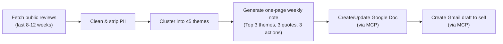

# Problem Statement — Groww Weekly Review Pulse (AI Workflows, Agents & Evals)

## 1. Overview

Build an AI workflow/agent for the **Groww** platform (Groww Stocks, Mutual Fund, IPO apps) that turns raw public app-store reviews into a **weekly one-page pulse** that the team can read in a few minutes:

- **What** users care about (themes)
- **What** they actually said (verbatim quotes)
- **What** to do next (action ideas)

The pulse goes out through tools people already use:
- **Google Docs** holds the written pulse.
- **Gmail** holds a draft email to yourself.

Both integrations go through **MCP (Model Context Protocol) servers**. Do not write your own credential handling or REST code.

## 2. Target Product

| Item | Value |
|---|---|
| Product | Groww: Stocks, Mutual Fund, IPO |
| Play Store | https://play.google.com/store/apps/details?id=com.nextbillion.groww&hl=en_IN |
| Play Package ID | `com.nextbillion.groww` |
| App Store | https://apps.apple.com/in/app/groww-stocks-mutual-fund-ipo/id1404871703?see-all=reviews&platform=iphone |
| App Store ID | `1404871703` (India storefront) |
| Sources | Google Play Store + Apple App Store (public reviews only) |

## 3. End-to-End Flow (Definition of Done)

1. **Ingest:** pull recent Play Store and App Store reviews, following the constraints below.
2. **Theme:** group the reviews into a small set of themes.
3. **Summarize:** write a one-page weekly note from those themes.
4. **Publish:** put the note in **Google Docs** so stakeholders can read it.
5. **Deliver:** create a **Gmail draft** to yourself (or an alias) that contains the pulse or links to it.

## 4. What Must Be Built

### 4.1 Review Ingestion
- Import reviews from roughly the **last 8–12 weeks**.
- Keep whatever fields the export provides, e.g. **rating, title, text, date**.

### 4.2 Theme Clustering
- Group reviews into **at most 5 themes**.
- Choose themes that fit the product. Examples: onboarding, KYC, payments, statements, withdrawals.

### 4.3 Weekly One-Page Note
The note must include:
- **Top 3 themes**, taken from the clustered themes and ranked by what people talk about most
- **3 real user quotes**, copied word for word from reviews with **no invented wording**
- **3 action ideas**: concrete next steps based on the themes

### 4.4 Delivery
- Create or update a **Google Doc** with the weekly note.
- Create a **Gmail draft** to yourself or an alias that contains the note or a clear link to it.

## 5. Integrations — MCP-First

| Surface | Purpose | Integration |
|---|---|---|
| Google Docs | Create/update the weekly pulse document | MCP server tools |
| Gmail | Create the draft email | MCP server tools |

- Use the **MCP servers/connectors** that the environment provides for Docs and Gmail.
- Do **not** make direct Google API integration (custom OAuth client + REST code) the main path.
- MCP servers expose tools that the agent or app calls. Relying on them keeps auth and HTTP plumbing in one place instead of duplicating it.

## 6. Key Constraints

| Area | Constraint |
|---|---|
| **Reviews** | Use **public review exports only**. No scraping behind store logins and no automation that violates ToS. |
| **Themes** | **At most 5 themes** for clustering. The pulse highlights the **top 3**. |
| **Length** | The note must be scannable, **≤ 250 words** where applicable. |
| **Privacy** | **No PII** in any artifact: no usernames, emails, device IDs, or other data that identifies a reviewer. Quotes must be anonymous, with identifying details removed as needed. |
| **Quotes** | Quotes must be **verbatim** from real reviews. Never paraphrase or invent them. |

## 7. Who This Helps

| Audience | Why |
|---|---|
| **Product / Growth** | Prioritize fixes and improvements based on real user signals |
| **Support** | Align messaging with what users are actually saying |
| **Leadership** | Get a one-page health check without reading raw reviews |

## 8. Deliverables Checklist

- [ ] Review ingestion pipeline (public sources, 8–12 week window)
- [ ] PII scrubbing step applied before any output
- [ ] Theme clustering (≤ 5 themes)
- [ ] Weekly one-page note (≤ 250 words): Top 3 themes, 3 verbatim quotes, 3 action ideas
- [ ] Google Doc created/updated via MCP
- [ ] Gmail draft to self/alias created via MCP, containing or linking to the note
- [ ] Evals: checks for quote faithfulness (verbatim), PII absence, theme count, and word limit
