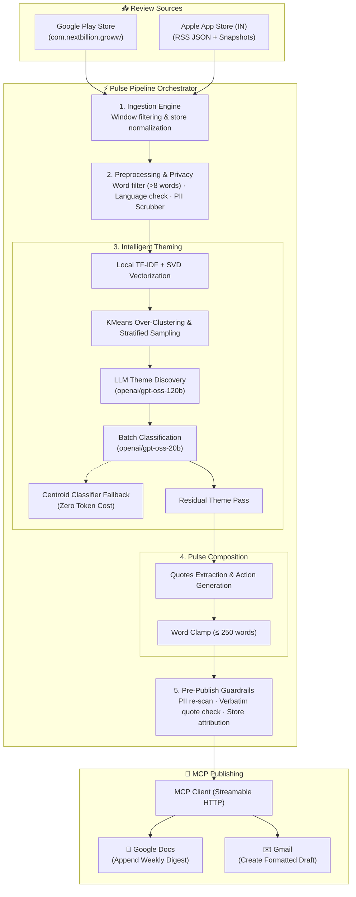

# 📊 Groww Weekly Review Pulse Agent

[](https://www.python.org/downloads/)
[](https://fastapi.tiangolo.com)
[](https://react.dev)
[](https://vitejs.dev)
[](https://modelcontextprotocol.io/)
[](https://groq.com/)
[](https://railway.app)
[](https://opensource.org/licenses/MIT)

> An autonomous end-to-end AI agent that transforms thousands of public **Groww** app reviews (Google Play Store & Apple App Store) into an executive-ready, **one-page weekly pulse**:
> 
> 🎯 **Top 3 Core Themes** · 💬 **3 Verbatim User Quotes** · 💡 **3 Actionable Product Ideas**  
> *(Strictly ≤ 250 words, 100% PII-free, automated Google Docs appending & Gmail draft delivery via Model Context Protocol)*

---

## 📑 Table of Contents

- [Overview](#-overview)
- [Key Features](#-key-features)
- [Architecture & Workflow](#-architecture--workflow)
- [LLM Cost Engineering & Budget Control](#-llm-cost-engineering--budget-control)
- [Interactive Web Dashboard](#-interactive-web-dashboard)
- [Quick Start](#-quick-start)
- [CLI Reference](#-cli-reference)
- [REST API Reference](#-rest-api-reference)
- [Guardrails & Evaluation Suite](#-guardrails--evaluation-suite)
- [Privacy & Security](#-privacy--security)
- [Configuration Matrix](#-configuration-matrix)
- [Production Deployment](#-production-deployment)
- [Project Layout](#-project-layout)
- [Contributing & License](#-contributing--license)

---

## 🌟 Overview

Product and engineering teams often drown in thousands of user reviews across stores, missing critical customer feedback or reacting to anecdotal noise. 

**Groww Review Pulse** automates the entire synthesis lifecycle:
1. **Ingests** real user reviews from both Google Play (`com.nextbillion.groww`) and Apple App Store (`id1404871703`, India storefront) over a rolling 8–12 week window.
2. **Cleans & Scrubs PII** with strict privacy filters (stripping emails, phones, names, personal identifiers, and emojis).
3. **Discovers Functional Themes** dynamically using KMeans clustering + high-reasoning LLMs, discarding generic sentiment fluff like *"good app"*.
4. **Classifies Every Review** using a budget-conscious two-model split and a trained scikit-learn TF-IDF fallback.
5. **Composes a Concise Executive Pulse** (≤ 250 words) with verifiable verbatim quotes and high-impact action recommendations.
6. **Publishes Directly** into Google Docs and drafts a Gmail digest via **MCP (Model Context Protocol)** servers without embedding raw Google OAuth credentials.

---

## ✨ Key Features

| Capability | Implementation Highlight |
|---|---|
| **Multi-Store Ingestion** | Concurrent fetching from Google Play (`google-play-scraper`) and Apple App Store RSS with automatic weekly snapshot accumulation to bypass store pagination limits. |
| **Strict Privacy Guardrails** | Sanitizes emails, phone numbers, addresses, account IDs, and reviewer names before LLM processing or disk persistence. |
| **Two-Model LLM Architecture** | Squeezes heavy NLP workflows into Groq's free tier by splitting reasoning tasks (`gpt-oss-120b`) from high-volume batch classification (`gpt-oss-20b`). |
| **Dynamic Rolling Budget Ledger** | Continuous simulation of Groq's 24-hour token bucket (+8.3k tokens/hour refill) with automatic TPM rate pacing to prevent 429 errors. |
| **Zero-Token Centroid Fallback** | Trains an in-memory classifier on cached LLM responses and TF-IDF/SVD centroids, ensuring 100% of reviews get tagged with zero additional token cost. |
| **Verbatim Quote Verification** | Guardrails perform exact string substring checks against clean review text to guarantee zero LLM hallucination in quoted feedback. |
| **MCP Integration** | Direct publishing via standard Model Context Protocol streamable HTTP clients to Google Docs & Gmail. |
| **Full-Featured Web Workspace** | Modern glassmorphic React dashboard with real-time pipeline controls, theme distributions, search filters, and audit logs. |
| **Continuous Weekly Scheduler** | Built-in background daemon scheduled for Monday 09:00 IST automated execution on Railway. |

---

## 🏗️ Architecture & Workflow



---

## 🧠 LLM Cost Engineering & Budget Control

Operating an enterprise-grade LLM pipeline entirely within **Groq's Free Tier** (200,000 tokens/day, 8,000 tokens/minute) requires rigorous cost engineering:

```
┌──────────────────────────────────────────────────────────────────────────────┐
│ Groq Free Tier Daily Quota (~200k tokens per model)                          │
├───────────────────────────────┬──────────────────────────────────────────────┤
│ Discovery & Compose (120B)    │ Classification Pass (20B)                    │
│ Model: openai/gpt-oss-120b    │ Model: openai/gpt-oss-20b                    │
│ Budget: ~20-30k tokens/run    │ Budget: ~55-60k tokens/run                   │
│ Ledger: data/llm_budget.json  │ Ledger: data/llm_budget_classify.json        │
└───────────────────────────────┴──────────────────────────────────────────────┘
```

1. **Two-Model Architecture:**
   - **Reasoning (`openai/gpt-oss-120b`):** Discovers top-level functional themes, names residual themes, and synthesizes action items.
   - **Classification (`openai/gpt-oss-20b`):** Classifies capped batches of reviews into theme buckets under its own separate daily allowance.
2. **Continuous Rolling Bucket:**
   - Groq’s limits replenish continuously at ~8,333 tokens/hour. The local budget ledgers calculate real-time availability instead of assuming a midnight reset.
3. **Paced Rate Limiting:**
   - LLM calls are throttled using proactive rate pacing so single batches never exceed the 8k TPM barrier.
4. **Multi-Tier Fallback:**
   - Only a representative sample of fresh reviews is sent to the LLM. The remainder are classified by an in-memory classifier trained on the LLM’s responses or by TF-IDF centroid proximity.
5. **Disk-Backed Caching:**
   - Responses are hashed by review ID, prompt, and model (`data/cache/`). Re-runs of the same week cost negligible tokens.

---

## 🖥️ Interactive Web Dashboard

The web workspace (`web/`) is built with React 18 and Vite:

* 📊 **Pulse Digest Tab:** Executive one-page view featuring top themes, star distributions, user quotes, and actionable recommendations.
* 🎯 **Themes Explorer Tab:** Deep dive into volume share, sentiment rating breakdowns, week-over-week momentum trends, and store balance.
* 💬 **Review Browser Tab:** Search and filter clean reviews by keyword, rating, store, or assigned theme.
* 🚀 **Publishing Control Tab:** Manage Google Doc targets, update email recipients, preview rendered HTML digests, and trigger manual publishes.
* ⚙️ **Runs & Audit Tab:** Full timeline of historical runs, wall-clock execution timings, token expenditure, and validator check results.

---

## ⚡ Quick Start

### Prerequisites
* **Python 3.11+**
* [**`uv`**](https://docs.astral.sh/uv/) (recommended for instant setup) or `pip`
* Free [Groq API Key](https://console.groq.com)
* Node.js 20+ *(only for running the web dashboard locally)*

### 1. Installation

```powershell
# Clone the repository
git clone https://github.com/theprachiverse/growwpulse_agent.git
cd growwpulse_agent

# Install dependencies and create virtual environment using uv
uv sync --extra web
```

### 2. Configure Environment

Copy `.env.example` to `.env` and provide your API keys:

```powershell
copy .env.example .env
```

Edit `.env`:
```env
LLM_PROVIDER=groq
LLM_API_KEY=gsk_your_groq_api_key_here
MCP_AUTH_TOKEN=your_mcp_bearer_token_here
MCP_SERVER_URL=https://your-mcp-server.example.com/mcp
PULSE_RECIPIENT=product-team@groww.in
```

### 3. Run Pipeline (Dry Run)

Test the complete pipeline without publishing to external services:

```powershell
.venv\Scripts\pulse.exe run --dry-run --skip-health-check
```

### 4. Check LLM Token Budget

Inspect token usage and next available execution windows:

```powershell
.venv\Scripts\pulse.exe budget
```

### 5. Start Local Web Dashboard

Open two terminals:

```powershell
# Terminal 1: Start FastAPI backend (:8000)
.venv\Scripts\pulse.exe serve

# Terminal 2: Start Vite frontend (:5173)
cd web
npm install
npm run dev
```

Visit **`http://localhost:5173`** in your browser.

---

## 🛠️ CLI Reference

The `pulse` CLI provides granular control over individual stages and end-to-end runs:

```
Usage: pulse [OPTIONS] COMMAND [ARGS]...

Commands:
  run          Execute the full automated end-to-end pipeline.
  fetch        Ingest reviews from Play Store and App Store into raw snapshots.
  preprocess   Clean reviews, scrub PII, and generate reviews_clean.jsonl.
  theme        Discover themes and classify reviews into buckets.
  compose      Select verbatim quotes and draft executive action ideas.
  publish      Publish existing pulse artifacts to Google Docs & Gmail via MCP.
  budget       Display current Groq token ledger and quota status.
  eval         Run the offline validation and compliance evaluation suite.
  serve        Launch the FastAPI backend server for the web dashboard.
  config       Print active runtime configuration.
```

### Common Command Examples

```powershell
# Run pipeline for a specific ISO week
pulse run --week 2026-W42 --dry-run

# Resume execution from a specific step
pulse run --from-step compose --dry-run

# Publish with live email delivery
pulse publish --week 2026-W42 --send --yes

# Run offline compliance evals
pulse eval --suite compliance
```

---

## 🔌 REST API Reference

The FastAPI service (`src/pulse/api.py`) powers the web interface:

| Endpoint | Method | Description | Auth Required |
|---|---|---|:---:|
| `/api/health` | `GET` | Health check, store connectivity, and credential presence | ❌ |
| `/api/status` | `GET` | Current job status, latest run summary, and token budget | ✅ |
| `/api/weeks` | `GET` | List of all available weekly runs and review counts | ✅ |
| `/api/weeks/{week}` | `GET` | Full pulse metadata, themes, and manifest for a week | ✅ |
| `/api/weeks/{week}/reviews` | `GET` | Filterable, paginated clean reviews with theme assignments | ✅ |
| `/api/run` | `POST` | Trigger asynchronous pipeline execution | ✅ |
| `/api/publish/settings` | `GET/POST`| Read or update default recipients and Google Doc IDs | ✅ |
| `/api/weeks/{week}/publish`| `POST` | Trigger live publishing (Google Doc / Gmail draft / email send) | ✅ |

*Note: When `PULSE_API_TOKEN` is configured, requests must supply the `X-Pulse-Token` header.*

---

## 🛡️ Guardrails & Evaluation Suite

Every pulse must pass strict automated gates defined in [`src/pulse/guardrails/`](file:///c:/NextLeap/Groww_review_AI-agent/src/pulse/guardrails):

- **Verbatim Quote Guarantee:** Strict substring check verifies that all quotes appear character-for-character in original reviews.
- **Strict Word Limit:** Final markdown pulse is hard-capped at **≤ 250 words** (targeting 220 words).
- **PII Cleanliness:** Zero phone numbers, emails, customer IDs, or reviewer names in outputs.
- **Top 3 Alignment:** Each of the 3 recommended actions maps directly to one of the Top 3 themes.
- **Balanced Store Coverage:** Ensures quotes reflect both Google Play and App Store users when data exists.

Run offline test validations without spending any LLM tokens:

```powershell
.venv\Scripts\pulse.exe eval --suite compliance
.venv\Scripts\python -m pytest -q
```

---

## 🔒 Privacy & Security

* **Zero PII Persistence:** Usernames, avatar URLs, developer replies, and personal identifiers are dropped at ingestion. Clean text is scrubbed before saving to disk or calling LLM APIs.
* **Credential Isolation:** Google OAuth credentials never touch this codebase; all workspace interactions route through authenticated Model Context Protocol (MCP) endpoints.
* **Safe Defaults:** Email actions default to creating **drafts**; live sending requires explicit `--send` flags and confirmations.
* **Audit Trails:** Every pipeline run writes a cryptographically structured `run_manifest.json` detailing inputs, execution time, token burn, and publication state.

---

## ⚙️ Configuration Matrix

Core settings live in [`config/config.yaml`](file:///c:/NextLeap/Groww_review_AI-agent/config/config.yaml):

```yaml
sources:
  play_store:
    enabled: true
    package_id: com.nextbillion.groww
    max_reviews: 10000
  app_store:
    enabled: true
    app_id: "1404871703"
    max_reviews: 500

ingest:
  window_weeks: 10           # Rolling window (8-12 weeks)
  min_words: 8               # Discard short non-actionable reviews
  english_only: true         # Filter foreign language reviews

theming:
  max_themes: 5              # Hard cap on discovered themes
  top_k: 3                   # Top themes in pulse
  batch_size: 50             # Batch size for classification

compose:
  max_words: 250             # Executive constraint
  target_words: 220

llm:
  model_chat: openai/gpt-oss-120b
  classify:
    model: openai/gpt-oss-20b
    max_reviews_per_run: 2000
```

---

## 🌐 Production Deployment

The project is pre-configured for containerized deployment:

```
[Users / Browser] ────► [Vercel] (Static React Dashboard + Proxy Function)
                              │
                              ▼ (Secure HTTPS with X-Pulse-Token)
                        [Railway] (Containerized FastAPI Backend + Worker)
                              │
                              ├── Volume: /data (State, Ledgers & Artifacts)
                              └── External: Google Docs & Gmail via MCP Server
```

### 1. Railway Backend
- Uses [`Dockerfile`](file:///c:/NextLeap/Groww_review_AI-agent/Dockerfile) (Python 3.12 + `uv` lockfile).
- Mount persistent volume to `/data` so runs, caches, and token ledgers survive container restarts.
- Set health check path to `/api/health`.

### 2. Vercel Frontend
- Build directory: `web`
- Output directory: `dist`
- Configured with `web/vercel.json` and `web/api/proxy.js` to securely forward requests to Railway while injecting `PULSE_API_TOKEN`.

---

## 📂 Project Layout

```
.
├── config/
│   ├── config.yaml               # Pipeline behaviour and model parameters
│   └── mcp_servers.yaml          # MCP endpoint and tool permission map
├── src/pulse/
│   ├── cli.py                    # Typer CLI application entrypoint
│   ├── orchestrator.py           # End-to-end execution pipeline coordinator
│   ├── api.py                    # FastAPI web application routes
│   ├── scheduler.py              # Automated weekly cron worker
│   ├── ingest/                   # Play Store scraper & App Store RSS fetchers
│   ├── preprocess/               # PII scrubbing, deduplication & normalization
│   ├── theming/                  # Clustering, LLM discovery & batch classification
│   ├── compose/                  # Pulse rendering, quote picker & word-clamp
│   ├── guardrails/               # Pre-publish validation checks
│   ├── publish/                  # MCP client for Google Docs & Gmail
│   ├── llm/                      # Groq client, embeddings & budget ledgers
│   └── run_store.py              # On-disk artifact persistence manager
├── web/                          # React + Vite dashboard frontend
│   ├── src/                      # UI components, tabs, styles & API client
│   └── api/proxy.js              # Serverless API proxy for Vercel
├── tests/                        # Full unit and integration test suite
├── evals/                        # Offline evaluation fixtures & benchmarks
├── deploy_data/                  # Seed database runs for zero-state deployments
├── Docs/                         # Design specifications & architecture docs
├── Dockerfile                    # Production backend container definition
├── railway.json                  # Railway deployment specifications
└── pyproject.toml                # Project metadata and dependencies
```

---

## 🤝 Contributing & License

Contributions are welcome! Please run quality checks prior to opening pull requests:

```powershell
.venv\Scripts\python -m ruff check src tests
.venv\Scripts\python -m ruff format --check src tests
.venv\Scripts\python -m mypy
.venv\Scripts\python -m pytest -q
```

Distributed under the **MIT License**. See `LICENSE` for details.
